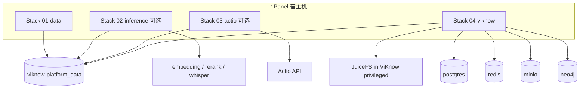

# ViKnow Platform（离线私有化 + 1Panel）

> **别和代码仓搞混**  
> **ViKnow Platform 应用源码**在 Gitea **`castmeta-research/viknow-platform`**（236：`/home/cursor-agent/src/viknow-platform`）。构建 Playground 镜像、跑 API/UI、Gitea Actions 都在**那个仓库**的 `deploy/236/`、`scripts/`。  
> **本目录**是跳板仓里的 **viknow2 客户离线多栈 Compose 模板**（historical 命名），与 Gitea 代码仓不是同一个东西。代码仓怎么构建见下文「代码仓对照」。

## 代码仓对照（Gitea `viknow-platform`）

| 目标 | 命令 / 入口 |
|------|-------------|
| 本地 editable 安装 | `pip install -e .` → `python -m viknow_platform`（默认 5175） |
| Dev Container | 仓库 `.devcontainer/`，`post-create` 拉 `external/HyperRAG` |
| 单测 | `pytest`（需 DSN，见 `docs/external-infra.md`；**不**起 PG） |
| 236 Playground **镜像** | `bash deploy/236/prepare-build-context.sh` → `docker build -f deploy/236/Dockerfile -t viknow-platform-playground:<tag> .` |
| 236 容器部署 | `bash deploy/236/deploy.sh <image>`（`api.env` + `secrets.env` + `ui.env`） |
| CI 一键 | Gitea **Actions → Playground 236**（`workflow_dispatch`，runner `python-312-uv`） |
| 文档站 | **Actions → Docs site** 或 `bash scripts/deploy-docs-site.sh` → `:3022` |

仓库 **不** 包含 Postgres/Redis/Neo4j compose；Playground 假定宿主机已由其它任务 provision（`docs/external-infra.md`）。与 **viknow2-app / jinhe 客户镜像** 是不同产品线。

---

**ViKnow Platform** 不是单个镜像，而是一套可重复打包的 **多栈 Compose 交付物**：中间件、推理侧车、可选 Actio、ViKnow 应用，通过 **同一 Docker 网络** 互联，在客户内网用 **1Panel「容器 → 编排」** 或 CLI `docker compose` 按顺序启动。

本目录描述 **怎么构建发包**、**包内长什么样**、**1Panel 上怎么装**。应用 compose 与 `deploy.env` 模板仍以 [`../viknow2-jinhe/`](../viknow2-jinhe/) 为权威（jinhe 客户拓扑）。

---

## 1. 架构分层



| 栈 | 目录 | 必选 | 说明 |
|----|------|------|------|
| 01-data | `stacks/01-data/` | 是 | Postgres（pgvector）、Redis、MinIO、Neo4j；创建共享网络 |
| 02-inference | `stacks/02-inference/` | 视合同 | 本地 embedding / rerank / Whisper（vLLM）；主 LLM 可走客户 LiteLLM，不必进本栈 |
| 03-actio | `stacks/03-actio/` | 否 | 视频切分、ASR/OCR 等；不部署则 `deploy.env` 用占位 URL（见 jinhe 最小 env） |
| 04-viknow | `stacks/04-viknow/` | 是 | `viknow2-app` + `deploy.env` + privileged + state 卷 |

**网络约定（全平台统一）：**

- 网络名固定为 **`viknow-platform_data`**（由 01-data 创建；其余栈 `external: true`）。
- `deploy.env` 里中间件 HOST 优先写 **Compose service 名**（`postgres`、`redis`、`minio`、`neo4j`），不要写宿主机映射端口。
- 推理服务名与 jinhe 模板对齐：`embedding`、`rerank`；Whisper 服务名现场自定，但 `VIKNOW_ASR_*` / HyperRAG 里要写一致。

---

## 2. 发包目录结构（NAS / U 盘）

建议与客户 NAS 包（如 `viknow2-for-jinhe-913`）同级命名：**`viknow-platform-<客户>-<YYYYMMDD>/`**。

```
viknow-platform-jinhe-20261103/
├── MANIFEST.yaml              # 版本、镜像列表、栈顺序（见 manifest.example.yaml）
├── README-ON-SITE.md          # 现场 1Panel 点击顺序 + 必改变量清单
├── images/                    # docker save 产物（可 part 分片）
│   ├── viknow2-app-<tag>.tar
│   ├── viknow-pgvector-<tag>.tar
│   └── ...
├── stacks/
│   ├── 01-data/
│   ├── 02-inference/          # 可选，整目录可省略
│   ├── 03-actio/              # 可选
│   └── 04-viknow/             # 含 docker-compose.yml + deploy.env.template
├── config-overrides/          # 可选：hyperrag.yml 片段、asr hotfix 说明
│   └── hyperrag.video-first_frame_image.snippet.yml
└── scripts/
    ├── load-all-images.sh
    └── smoke.sh
```

**最小包（客户已有 DB + LiteLLM）：** 只带 `images/viknow2-app-*.tar` + `stacks/04-viknow/`，`VIKNOW_DATA_NETWORK` 指向客户已有网络（同 [`viknow2-jinhe`](../viknow2-jinhe/README.md)）。

**完整离线包：** 01 + 02 + 04；有视频索引/Actio 能力再加 03。

---

## 3. 构建流水线（研发侧）

构建发生在 **236 / CI**（业务仓 Gitea `castmeta-research/viknow2`），跳板仓只存 **模板与 manifest**，不 bake 镜像。

### 3.1 定版本

在 `MANIFEST.yaml` 写清：

- Git commit / 镜像 tag（如 `viknow2-app:56d8705e5feb`）
- 配置包：`config/jinhe` 是否已 bake 进镜像（jinhe 交付一般为 **是**）
- 依赖中间件镜像 tag（pgvector、redis、minio、neo4j 与 236 test-data 对齐）

### 3.2 打应用镜像

在 viknow2 仓库（与现网 deploy-test 一致）：

1. 目标分支 / commit 通过 CI 或 `scripts/deploy-app-docker.sh`（名称以仓库为准）产出 **`viknow2-app:<short-sha>`**。
2. 确认镜像内 `VIKNOW_CONFIG=/opt/viknow/config/jinhe/app.yaml` 路径存在且 **Langfuse / Token Gateway 关闭**。
3. 记录 tag，写入 MANIFEST。

### 3.3 导出镜像

```bash
# 示例：应用 + 数据栈（镜像名以 MANIFEST 为准）
docker save -o images/viknow2-app-56d8705e5feb.tar viknow2-app:56d8705e5feb
docker save -o images/viknow-data-bundle.tar \
  viknow/pgvector-textsearch:pg18-trixie-v1.3.1 \
  redis:7-alpine \
  minio/minio:RELEASE.2024-xx \
  neo4j:5-community
```

大文件分片：

```bash
split -b 2G viknow2-app-56d8705e5feb.tar viknow2-app-56d8705e5feb.tar.part-
# 现场：cat viknow2-app-*.tar.part-* > viknow2-app-56d8705e5feb.tar
```

### 3.4 生成客户 `deploy.env`

1. 从 [`../viknow2-jinhe/deploy.on-site-minimal.env`](../viknow2-jinhe/deploy.on-site-minimal.env) 复制为 `stacks/04-viknow/deploy.env.template`。
2. 预填 **非密钥** 项：模型名、service 名、schema 名、`HYPERRAG_PROMPT_ENV=jinhe`。
3. 密钥留空或 `CHANGE_ME`；**禁止** `KEY=value # 注释`（docker env_file 会把 `#` 后内容读进值）。
4. 若使用平台 inference 栈，确认：
   - `VIKNOW_EMBEDDING_BASE_URL=http://embedding:8611/v1`
   - `HYPERRAG_RERANK_BASE_URL=http://rerank:8602/v1`
   - Whisper：`VIKNOW_ASR_MODEL` / LiteLLM 路由与 02 栈服务一致。
5. 视频索引若遇 embedding 500（`temporal_factor`）：在 **`config-overrides`** 提供 `video_embedding_params.local_video_mode: first_frame_image` 说明，并写清挂载到 `/opt/viknow/config/jinhe/hyperrag.yml` 或 `.state` 物化路径（见 jinhe 运维笔记）。

### 3.5 Whisper / ASR 加固（强烈建议写进 MANIFEST notes）

- vLLM Whisper 容器需 **`soundfile` + `av`**（`pip install soundfile av` 或离线 wheels）；**`docker restart` 可保留**，**`compose recreate` 会丢容器内 pip 层** → 应做 **自定义镜像** 或 **entrypoint 安装脚本** 再发包。
- 可选：**whisper 转码 sidecar**（NAS 已有 proxy 包时一并列入 MANIFEST optional_components）。

### 3.6 校验

在 236 或 CI runner：

```bash
bash scripts/load-all-images.sh
cd stacks/01-data && docker compose --env-file .env config
cd ../04-viknow && export VIKNOW_DATA_NETWORK=viknow-platform_data VIKNOW_IMAGE=...
docker compose --env-file .env config
bash scripts/smoke.sh
```

`smoke.sh` 最低标准：`curl -sf http://127.0.0.1:${VIKNOW_HOST_PORT}/docs` → 200。

### 3.7 发布

1. 上传目录到客户 NAS / SFTP（Synology 大 tar 建议 rsync/scp，避免 QuickConnect 卡 0%）。
2. 同步跳板仓 `deliverables/viknow-platform` 与 `viknow2-jinhe` 模板变更（GitHub + 如需 Gitea 文档镜像）。
3. 阿里云侧如有 ACK/ACR 操作，按根目录 `AGENTS.md` 追加 `docs/cloud-ops-log.md`（本包纯离线时可跳过）。

---

## 4. 1Panel 部署要点

详细步骤见 [`1panel/README.md`](1panel/README.md)。核心三条：

1. **两套 env 文件**
   - 编排目录下的 **`.env`**：只给 Compose **插值** `${VIKNOW_IMAGE}`、`${VIKNOW_DATA_NETWORK}` 等。
   - **`deploy.env`**：通过 `env_file` 注入 **容器内**；1Panel「环境变量」页编辑的是后者，**不能**替代 compose 的 `.env`。
2. **必须从 1Panel 创建编排**（或 UI 导入 stack），否则后续启停、日志、改 env 不在同一生命周期里。
3. **启动顺序**：01-data（健康）→ 02-inference → 03-actio → 04-viknow；改 `deploy.env` 后 ViKnow 需 **`docker compose up -d --force-recreate --no-deps`**（仅 restart 不会 reload env_file）。

---

## 5. 与客户已有 infra 的两种模式

| 模式 | 带哪些栈 | `VIKNOW_DATA_NETWORK` |
|------|----------|------------------------|
| **Greenfield** | 01 + 02 + 04（+03） | `viknow-platform_data` |
| **Brownfield** | 仅 04 | 客户现有 data compose 网络名 |

Brownfield 与 [`viknow2-jinhe`](../viknow2-jinhe/README.md) 完全一致；Platform 只是把 **可选组件** 标准化成 01–03 模板，便于 1Panel 多应用管理。

---

## 6. 与「只发一个 tar」的关系

- **最小交付**仍可以是：1 个 `viknow2-app` tar + `deploy.env` + 小 compose（jinhe 包）。
- **Platform 交付** = 最小交付 + **标准化多栈 + manifest + 1Panel SOP + 可选 inference/actio 镜像**，适合「现场无运维、全靠面板点选」的合同。

---

更新：2026-11-03
