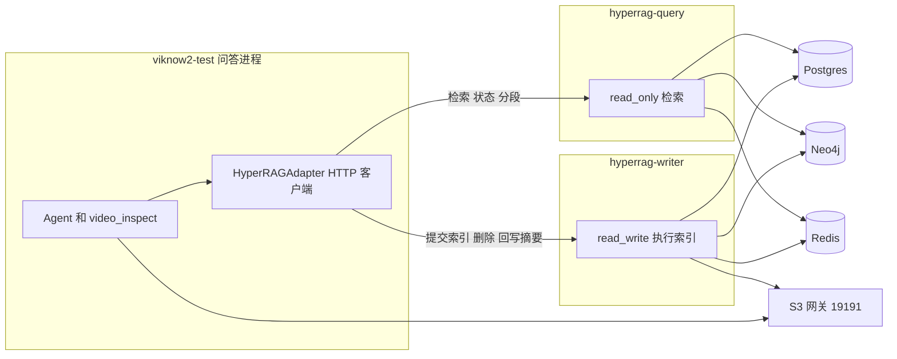

# HyperRAG 从 ViKnow 拆出：实施方案

事实来源是 236 上正在运行的 `viknow2-test`，镜像 `viknow2-app:secretary-output-limit-8eff6f7e1d64`，配置 `VIKNOW_CONFIG=/opt/viknow/config/test/app.yaml`。进程内的 HyperRAG 在 `/opt/viknow/external/HyperRAG`。下面的判断以这个容器里的代码和配置为准，不以开发目录里另一份 checkout 为准。

**viknow3 / HyperRAG 集成（`agent/hyperrag-dev3`）的配置原则**：运维**不要**维护仓库 YAML。连接、模型、检索默认值等**只写在 Postgres `viknow_ops`**（`/api/v1/om/config`）。进程启动时从 ops 物化**临时** `state_dir/hyperrag/hyperrag.yml`，仅供 HyperRAG 子模块 `load_config_from_yaml`；给人看的界面是 OM API / 数据库，不是 YAML 文件。

本文只定方案，不改 `viknow2-test` 容器。

---

## 1. 结论

1. HyperRAG 从 `viknow2-test` 这个进程里拆出去。问答 API 不再 `initialize()`，不再在本进程跑解析和索引任务。
2. ViKnow 调用 HyperRAG 用 **HTTP SDK**，不使用 MCP。现有的 `HyperRAGAdapter` 留下来当客户端门面。证据组装、引用编号、`video_inspect` 仍留在 ViKnow。
3. 读写分离用 HyperRAG 已经有的 `InstanceMode`，不要另写一套锁。查询进程 `initial_mode: read_only`，只启动存储和检索。写入进程只有一个，`initial_mode: read_write`，并且把 `enable_rw_lock` 打开。

236 上第一期就两个新容器，都不要和 `viknow2-test` 共用 cgroup：

| 角色 | 数量 | 模式 | 做什么 |
| --- | --- | --- | --- |
| `hyperrag-query` | 先 1 个，确认稳定后再加 | `read_only` | 检索、资产状态、分段、库列表 |
| `hyperrag-writer` | 只允许 1 个 | `read_write` + Redis RW 锁 | 建索引、删除、视频摘要回写、`post_compile` |

Postgres、Redis、Neo4j、S3 网关（`19191` / bucket `viknow`）继续共用现有的 test 数据栈。第一期不要加数据库只读副本。副本会带来可见性延迟，而检索要马上看见刚写完的 chunk。

---

## 2. 现在为什么会互相抢

`viknow2-test` 启动时调用 `HyperRAGAdapter.start_background_runtime()`，里面是 `initialize()`。`config/test/hyperrag.yml` 写的是：

- `initial_mode: read_write`
- `enable_rw_lock: false`

于是这一个 API 进程会 `switch_to_rw()`，并在名为 `hyperrag-adapter-loop` 的线程里 `scheduler.start()`。索引 worker、心跳、`post_compile` 和所有检索调用都在这一个事件循环上。

适配器还有两把只在本进程有效的闸门：`runtime_concurrency: 64` 和 `sync_bridge_concurrency: 64`。它们限制的是「谁可以进这个循环」，并不把 CPU 分成两半。

检索本身并不需要任务运行时。`aquery_data` 走到 `_query_hybrid`，只要求 `_ensure_bm25_runtime()`。把 worker 拉起来的是两处：

- 进程启动时的 `initialize()`
- `aadd_asset()` 开头的 `if not self._initialized: await self.initialize()`

所以只要有人在一个配成 `read_write` 的进程里提交索引，这个进程就会变成执行者。`enable_rw_lock: false` 时，`switch_to_rw()` 不抢锁，直接执行。两个这样的进程会同时消费同一条队列。

统一调度是开着的（`VIKNOW_UNIFIED_SCHEDULER_ENABLED=true`，`max_concurrent_job_tasks: 10`）。索引入队走 `scheduler-core`，和 ViKnow 的 vLLM 租约共用 `share.redis` 里物化出来的那一个 Redis。拆进程不会自动把这条 Redis 分开。

资源上，这个容器此刻的匿名内存大约 1 GiB，`uvicorn` RSS 大约 1.3 GiB，容器显示的大约 7.5 GiB 里有大约 6 GiB 是文件页缓存。`/tmp/viknow-scratch/knowledge` 大约 1.1 GiB，是从 S3 网关拉下来的本地副本，不是 JuiceFS 挂载。`VIKNOW_JUICEFS_ENABLED=false`，`/data/viknow` 不是这块盘的挂载点。建索引和 `video_inspect` 都会把整段 `*.normalized.mp4` 拉到本容器磁盘。解析子进程（MinerU、ffmpeg、Actio）一旦起来，就和问答抢同一个 CPU 和同一份页缓存。

任务并发在配置里已经卡住了，但仍然和问答同进程：文档解析 2、视频解析 2、索引 2、视频向量 4；`task_limits` 里 `doc_parse` 是 1、`kg_index` 是 2。`post_compile` 每 15 分钟在写入模式下跑，热边阈值 5000，每轮最多 2 批、每批 5000。lint 在凌晨 2 点到 6 点。这些都会打到同一套 Postgres 和 Neo4j。

---

## 3. 部署

### 3.1 查询进程

- 启动只调用 `initialize_readonly()`，也就是 `_ensure_core_runtime()`。不要调用 `initialize()`。
- `initial_mode: read_only`。不要 `switch_to_rw()`，不要 `scheduler.start()`，不要 `_post_compile_loop()`。
- 可以水平扩展。每个进程都会加载 jieba 和 BM25 访问层，内存按副本相加。236 上先跑 1 个，和现在的单进程检索持平。
- 不安装「我来执行解析」的职责。Actio 视频解析和 MinerU 子进程不要出现在这个容器里。检索仍然要能读已经写入 Postgres / Neo4j / 向量库的结果。
- 工作目录用自己的 scratch。网关模式下 `working_dir` 会被物化成该容器内的 `/tmp/viknow-scratch/hyperrag`，不要把 `viknow2-test` 的 `/tmp` 挂给它。

### 3.2 写入进程

- 全局只跑 1 个。`initial_mode: read_write`，`enable_rw_lock: true`。锁在 Redis 里，第二个进程 `try_acquire_rw_lock` 失败后必须保持只读并退出或待命，不能靠「锁默认关闭」来调试。
- 这个进程执行 `scheduler.start()`、心跳续锁、`post_compile` 和 lint。
- CPU 给这个容器，不要和 `viknow2-test` 绑在同一个 cgroup。磁盘给 scratch 单独留空间：视频会整段下载，规范化文件、Actio 中间产物都在本地，完成后再 `put_file` 回网关。
- 不接用户问答流量。健康检查和索引进度可以打在这个进程上。
- Actio、ffmpeg、MinerU（`mineru_backend: vlm-http-client`）只放在这里。模型权重仍在远端 vLLM，不要把 GPU 划给这个容器。

### 3.3 问答进程

- 去掉启动时的 `start_background_runtime()` → `initialize()`。
- `HyperRAGAdapter` 不再在本进程 `sys.path` 插入 HyperRAG 再 `import HyperRAGV2`。
- `video_inspect` 不动。它仍会按对象键把整段规范化视频下载到本容器 scratch，看完再删。拆 HyperRAG 解决不了这一下。

### 3.4 数据栈

继续用 test 现有的 Postgres、Redis、Neo4j 和 S3 网关。查询和写入连同一个主库，这样刚索引完的 chunk 对检索可见，没有副本延迟。

连接数要收。现在 HyperRAG 环境里写了 `POSTGRES_MAX_CONNECTIONS: '1000'`，这是客户端配置项，不是 Postgres 服务器已经允许 1000。拆成两个进程后，连接池会乘上去。查询进程和写入进程各自设小池，加起来留在 test Postgres 实际 `max_connections` 以内。上线前看一眼服务器的 `max_connections` 和现有连接数。

Redis 第一期仍然共用。索引任务和 vLLM 租约都在里面。写入进程必须连这同一个 Redis，否则在途 job 和统一调度的 DAG 会断。不要为了「隔离」另起一个空 Redis 就把旧队列丢了。

---

## 4. 调用方式：SDK，不用 MCP

MCP 是给模型当工具用的。HyperRAG 的调用方是 ViKnow 代码，不是模型。模型已经通过 `knowledge_search` 这类工具进来，后面还有库权限、证据结构和引用编号。把检索或建索引做成 MCP 工具，模型就可以绕过这些规则，也可以自己提交索引。

进程内的 `HyperRAGAdapter` 已经是边界。拆出去之后，这个类的方法签名保持不变，内部从「在 `hyperrag-adapter-loop` 里调用 `HyperRAGV2`」改成 HTTP。OpenAPI 只服务这个客户端，不面向浏览器，也不注册进 Agent 的 tool list。

传输用 JSON HTTP 就够。检索是一次请求一次结构化结果，没有 token 流。不引入 gRPC。

### 4.1 两个基址

适配器配置两项，不要用一个 URL 再靠路径去猜角色：

- `query_base_url`：只读
- `writer_base_url`：提交和回写

查询进程拒绝一切写请求。写错 URL 时要失败，而不是在查询进程里把 `initialize()` 调起来。

### 4.2 读接口（查询进程）

对应今天适配器上这些调用：

| 用途 | 今天的方法 |
| --- | --- |
| 混合检索 | `search_async` / `search` |
| 以图搜 | `search_by_image_async` |
| 预编译上下文 | `query_kg_async` |
| 资产状态、chunk 数 | `get_asset_status`、`get_asset_chunk_count` |
| 分段、单 chunk | `list_asset_segments`、`get_chunk_by_id` |
| 库目录和发现 | `list_libraries_async`、`search_libraries_async`、`discover_libraries_async` |
| 视频语义和摘要 | `get_video_semantic_async`、`get_video_summary_async`、`list_video_assets_async` |

返回体里的文件位置必须是对象键（`knowledge/assets/{asset_id}/...`）或已经可签名的引用，不能是写入容器的 `/tmp/viknow-scratch/...`。

`_build_evidence`、引用、库 ACL、`sign_browser_reference` 留在 ViKnow。查询服务返回 chunk 和元数据，不返回 ViKnow 的 `Evidence` 对象。

### 4.3 写接口（写入进程）

| 用途 | 今天的方法 |
| --- | --- |
| 提交索引 | `submit_index_async` |
| 删除 | `delete_index_async` |
| 回写视频全局摘要 | `update_video_global_summary_async` |
| 导入包 | `import_knowledge_package_async` |

导出包可以放在查询进程。它不执行解析。

提交索引的请求体改成对象键，不再传调用方磁盘上的绝对路径。今天 `complete_upload` 把 scratch 上的 `*.normalized.mp4` 路径交给 `aadd_asset`，状态里的 `file_path` 也是这条路径。查询进程和写入进程的 `/tmp` 互不可见。写入进程拿到对象键后自己 `materialize_object`，解析完再 `put_file` 回网关。`viknow2-test` 的 scratch 里已经能看到这个键的形状，例如 `knowledge/assets/{asset_id}/upload/{asset_id}.normalized.mp4`。

### 4.4 鉴权

内网加上一个服务 token。写接口和读接口分开授权。不要把写接口映射到任何 Agent 工具。

超时：检索跟现在的问答预算走；提交索引只等「入队成功」，不等解析结束。进度继续用资产状态接口轮询，和现在的上传管理器一样。

---

## 5. 读写分离怎么落到现有代码

不要新写调度器。`TaskScheduler` 里已经有：

- `READ_ONLY`：可查询、可提交，不执行
- `READ_WRITE`：可查询、可提交、可执行
- `switch_to_rw()`：锁关闭时直接执行；锁打开时要拿到 Redis RW 锁才 `start()`
- `submit_job()`：只入队。统一调度开着时写入 `scheduler-core`，不要求本进程已经 `start()`

要改的是调用方式，避免只读进程被误启动成写入进程。

1. 查询进程的启动路径改为只调用 `initialize_readonly()`。禁止在查询进程调用 `initialize()`。
2. `aadd_asset()` 里「未初始化就 `initialize()`」只能留在写入进程。查询进程不提供提交接口。如果写请求打到查询进程，直接 4xx，不要顺手把 scheduler 拉起来。
3. 写入进程启动时 `initialize()`，并且只有 `enable_rw_lock: true` 且抢锁成功才 `start()`。抢锁失败就退出，让编排重启或待命，不要降级成无锁写入。
4. `post_compile` 和 lint 只在写入进程。查询进程的配置里 `post_compile_auto_enabled: false`。
5. 适配器上的 `runtime_concurrency` 不再代表「索引和检索共享的 64」。查询服务自己设检索并发；写入服务的并发继续用现有的 `task_limits` 和 `max_concurrent_job_tasks: 10`。

同一时刻仍然会共享 Postgres、Neo4j 和 Redis。进程分开之后，索引的 ffmpeg / MinerU / 整段视频下载不再占问答进程的 CPU 和页缓存。数据库被 `post_compile` 打满时，检索仍会变慢。这是下一期的事，不是这一期用只读副本能干净解决的。

---

## 6. 实施顺序

每一步都可以单独退回。退回手段是问答进程重新打开进程内 `initialize()`，并停掉新容器。不要在退回完成前停 `viknow2-test` 里正在跑的写入，除非队列里的 job 已经确认由新写入进程接手。

### 第 1 步：对象键契约

在还不拆进程时改提交和状态：

- 上传完成后，交给 `aadd_asset` 的是对象键，不是 `/tmp/viknow-scratch/...`。
- 资产状态里的 `file_path` 改成对象键。已有行要迁移；迁移前把现有 `file_path` 的形态抽样核对一遍（scratch 绝对路径、对象键、旧的 `/data/viknow` 路径可能并存）。
- `resolve_media_path` 继续按对象键从网关下载。`video_inspect` 的行为保持不变。
- 索引完成时，解析产物用现有的 `publish_gateway_artifacts` / `put_file` 回到网关，不依赖写入进程的本地目录被别人挂载。

这一步不过，拆出去之后写入进程会去打开另一个容器的路径。

### 第 2 步：把写入锁打开，但仍在一个进程里验证

只在一个临时容器里做，不要改正在服务的 `viknow2-test` 的锁配置直到验证通过。

- `enable_rw_lock: true`，仍然一个 `read_write` 进程。
- 确认心跳会续锁，进程重启后锁会过期、新进程能接上。
- 确认第二个进程抢不到锁时不会执行任务。

`viknow2-test` 今天是无锁单写入。直接在它上面打开锁之前，要确认没有另一个被忘掉的进程也在消费 `hyperrag:` 或统一调度队列。

### 第 3 步：同镜像两个进程，ViKnow 仍进程内

用 `viknow2-test` 这套镜像先拉出 `hyperrag-writer` 和 `hyperrag-query`，配置按第 3 节。此时代码路径可以还是进程内库，只是入口不同：查询进程只 `initialize_readonly()`，写入进程 `initialize()`。

先把索引流量指到写入进程，检索仍留在 `viknow2-test` 里观察。确认写入进程执行任务时，问答进程的 CPU 和页缓存不再跟着涨。然后再把检索指到查询进程。

在途 job：切换写入者时，旧进程必须先 `switch_to_ro()` / `stop()`，等 Redis 锁释放或过期，新进程再抢锁。统一调度开着时，不要两个 worker 循环同时 `start()`。

### 第 4 步：HTTP，适配器变客户端

在写入进程和查询进程上加一层薄 HTTP，方法对应第 4 节的表。`HyperRAGAdapter` 用配置切换进程内或 HTTP。默认在 test 上切到 HTTP 之后，再删进程内启动。

客户端超时、入队返回的 `job_id`、状态轮询要和现在的 `KnowledgeUploadManager` 对齐。不要让上传接口等到解析结束。

### 第 5 步：从问答进程拿掉运行时

`viknow2-test` 不再调用 `start_background_runtime()`。镜像里可以暂时留着 HyperRAG 源码，但进程不再初始化它。观察一轮索引和问答之后，再考虑镜像分层：问答镜像不带 Actio 解析和 MinerU。

---

## 7. 需要你拍板或提前看住的地方

1. **对象键迁移。** 状态表里的 `file_path` 今天多半是提交时的本地路径。拆分前必须迁成对象键，并确认网关上的对象还在。旧的 `/data/viknow/...` 路径在这个容器里已经不是挂载盘，迁不走的资产要单独列出来。
2. **在途索引。** 切换写入进程时，正在 `PARSING` / `INDEXING` 的资产不能有两个执行者。先停旧 scheduler，再让新进程抢锁。统一调度和 vLLM 共用 Redis，停的是 HyperRAG worker，不是 vLLM。
3. **锁的默认值。** `enable_rw_lock: false` 不能带到任何会水平扩展的环境。查询副本如果误配成 `read_write`，会和写入进程一起执行。
4. **`aadd_asset` 会自启动写入。** 这是现在的代码行为。查询进程只要暴露了提交并走到这个函数，就会把 worker 拉起来。写接口必须只存在于写入进程。
5. **数据库仍然共享。** 进程拆开后，问答不再被 ffmpeg 和整段视频下载拖住。`post_compile`（15 分钟一轮）和凌晨 lint 仍会压 Postgres 和 Neo4j。第一期接受这一点。不要同时上只读副本，否则检索会读到还没落下来的索引。
6. **Postgres 连接数。** 两个新进程都会建池。先看 test 库的 `max_connections` 和当前用量，再写客户端池大小。不要把环境里的 `POSTGRES_MAX_CONNECTIONS=1000` 理解成服务器容量。
7. **Redis 不能拆成两套空库。** 索引队列和统一调度的 DAG 在现有 Redis 里。新写入进程要连同一实例。隔离方式是分开 key 前缀和「只有一个执行者」，不是换一个空 Redis。
8. **`video_inspect` 仍会下载整段视频。** 它留在问答进程，按对象键从网关 `fget_object` 到 `/tmp/viknow-scratch`，工具结束再删。2GB 源文件的压力在问答进程的磁盘和页缓存上，不在 HyperRAG 查询进程上。
9. **scratch 不能做成共享卷。** 每个进程用自己的 `/tmp/viknow-scratch`。跨进程只通过对象键和数据库交换。
10. **镜像和代码版本。** 这份方案对着 `secretary-output-limit-8eff6f7e1d64`。开发目录 `/home/cursor-agent/work/viknow2` 不一定等于这个镜像。改代码时先对齐这个镜像对应的 commit，再在新容器里验证，不要直接改 `viknow2-test` 正在跑的容器。
11. **密钥。** 新容器需要和 test 相同的数据库、Redis、S3 网关环境变量。不要把 `deploy.env` 抄进仓库。
12. **第一期范围。** 不包含：MCP、数据库读写分离、把 `video_inspect` 移出问答进程、把 Actio 再拆成第三个服务。写入进程可以继续在进程内调用 Actio，和现在的 `VideoParseHandler` 一样。

---

## 8. 验收

在 `viknow2-test` 保持问答的前提下，用一个新容器跑写入：

- 提交一条视频索引时，`viknow2-test` 的进程 CPU 和匿名内存不随 ffmpeg / 下载上涨。页缓存上涨应出现在写入容器。
- 索引进行中，对查询进程发检索，能返回；写入进程不接受检索流量。
- 再起一个 `read_write` 进程时，它拿不到 RW 锁，队列里的任务不会被执行两次。
- 查询进程的配置若被误打成写请求，返回失败，进程内没有 `TaskScheduler started` 日志。
- 索引完成后，问答侧 `video_inspect` 仍能用对象键打开规范化视频，不依赖写入容器的本地文件还在。
