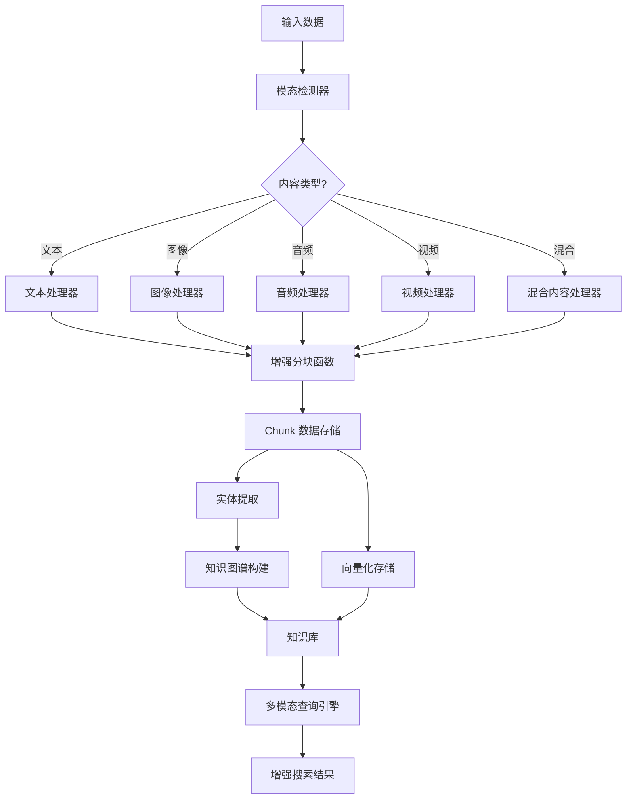

# HyperRAG 数据流分析

## 运行时并发设计（HyperRAG Runtime Concurrency）

本节描述 HyperRAG 的并发与调度机制，覆盖实例模型、任务队列、状态存储、取消语义与跨平台文件锁。

- 实例模型
  - 每个 workspace 仅允许一个 HyperRAG 活跃实例（单活）。
  - 进程内由注册表 `registry.get_instance(workspace)` 管理单活；跨进程通过文件锁互斥，避免同一 workspace 被多进程占用。

- 文件锁（跨平台）
  - 使用 `portalocker` 对 `working_dir/{workspace}/.hyperrag.lock` 加独占锁，写入 `pid/时间戳` 便于诊断。
  - 抢锁失败时在报错信息中输出锁持有者信息；退出时通过 `atexit` 与 `stop()` 确保释放锁。

- 事件循环与线程模型
  - HyperRAG 在专用线程中常驻一个 `asyncio` 事件循环（`start()` 启动，`stop()` 关闭）。
  - 跨线程调用通过 `asyncio.run_coroutine_threadsafe` 安全投递协程。

- 任务分发与队列
  - 仅“索引（ingest）”走队列：内部 `asyncio.Queue` 做背压与并发控制，队列项处理完毕调用 `task_done()`。
  - “查询（search）”不走队列，直接在事件循环内调用 `HyperRAG.aquery`，降低延迟。
  - 启动时初始化 HyperRAG 共享存储：`initialize_share_data()` 与 `initialize_pipeline_status()`，并显式 `await hyperrag.initialize_storages()`。

- 解析与 CPU 绑定任务
  - 解析阶段为同步阻塞操作，使用 `await asyncio.to_thread(self.parser.parse_document, ...)` 放入线程池执行，避免阻塞事件循环。
  - 解析心跳：解析进行中每 2s 刷新一次 `PARSING` 的 `updated_at`，直至完成或失败。

- 取消与失败语义
  - 捕获 `asyncio.CancelledError` 将状态置为 `CANCELLED`；其他异常记为 `FAILED` 并 `logger.exception(...)` 输出堆栈。
  - 队列消费任务在任意完成路径均调用 `task_done()` 回收令牌。

- 状态存储（AssetStatusStorage）
  - 记录 `QUEUED → PARSING → CHUNKING → INDEXING → COMPLETED` 的进度；错误置 `FAILED`，取消置 `CANCELLED`。
  - 不使用“分布式租约”，原因：每个 workspace 单活实例，队列只有一个消费者；持久化状态仅做观测与恢复。

### 数据/控制流（索引）

```mermaid
flowchart TD
    C[调用 add_asset(_sync)] -->|写 QUEUED| S[(AssetStatusStorage)]
    C -->|入队| Q[asyncio.Queue]
    subgraph HyperRAG 事件循环线程
      Q --> W1[_worker]
      W1 -->|PARSING\n心跳刷新| S
      W1 -->|to_thread(parse_document)| P[解析线程池]
      P --> W1
      W1 -->|CHUNKING| S
      W1 -->|INDEXING| S
      W1 -->|HyperRAG.ainsert| L[HyperRAG]
      L --> W1
      W1 -->|COMPLETED/FAILED| S
      W1 -->|task_done()| Q
    end
```

### 数据/控制流（查询）

```mermaid
flowchart LR
    U[query(_sync)] --> E[事件循环线程]
    E -->|QueryParam(mode)| L[HyperRAG.aquery]
    L --> E --> U
```

### 关键配置与扩展点
- `max_workers`: 队列并发消费的 worker 数量。
- 解析心跳间隔：当前固定为 2 秒，可按需参数化。
- 启动恢复：可扫描 `QUEUED/PARSING/INDEXING` 任务重新入队（可选扩展）。

## 完整数据处理流程



## 详细处理阶段

### 1. 输入处理阶段
```python
输入数据 → 模态检测 → 预处理 → 文本转换
```

**关键组件:**
- `_detect_modality()`: 检测内容类型
- `_process_multimodal_content()`: 多模态内容处理

### 2. 分块阶段（HyperChunker）
```python
{"asset": {...}, "segments": [...]} → 段感知处理 → token 窗口聚合 → 输出 chunk 列表
```

**输入**
- JSON 字符串：`{"asset": {...}, "segments": [{segment...}]}`

**聚合规则**
- 文本段顺序累加，窗口不超过 `max_token_size`，按需添加 `overlap_token_size` 尾部重叠（字符近似）。
- 图片/表格段各自成为独立 chunk，不与其它段合并；超长时在该段内切分。
- 对于 `image/table`，上下文拼接前后各 3 段文本摘要。

**输出字段（最小集）**
```json
{
  "content": "...",
  "tokens": 123,
  "chunk_order_index": 0,
  "doc_id": "doc-xxx",
  "segment_ids": ["seg-0001", "seg-0002"],
  "text": "...",
  "token_count": 123,
  "order": 0,
  "extra": {}
}
```

### 3. 存储与索引阶段
```python
增强Chunk → KV存储 → 向量存储 → 实体提取 → 知识图谱
```

**存储位置:**
- `text_chunks`: KV存储，保留所有字段（包含我们输出的最小集）
- `chunks_vdb`: 向量存储，用于语义检索
- `entities_vdb`: 实体向量存储
- `relationships_vdb`: 关系向量存储

### 4. 查询处理阶段
```python
用户查询 → 向量检索 → 知识图谱查询 → 结果增强 → 返回
```

**查询增强:**
- 利用自定义字段进行过滤
- 多模态相关性计算
- 结果排序和重排

## 自定义字段在流程中的作用

### 存储阶段
```python
# hyperrag.py:1264-1270
chunks: dict[str, Any] = {
    compute_mdhash_id(dp["content"], prefix="chunk-"): {
        **dp,  # 🔑 完整保留所有自定义字段
        "full_doc_id": doc_id,
        "file_path": file_path,
        "llm_cache_list": [],
    }
    for dp in self.chunking_func(...)
}
```

### 实体提取阶段
```python
# operate.py:1574-1576
content = chunk_dp["content"]
file_path = chunk_dp.get("file_path", "unknown_source")
# 可访问所有自定义字段:
keywords = chunk_dp.get("keywords", [])
modality = chunk_dp.get("modality", "text")
```

### 查询阶段
```python
# operate.py:2016-2022
chunk_with_metadata = {
    "content": result["content"],
    "file_path": result.get("file_path", "unknown_source"),
    # 可包含所有自定义字段:
    "keywords": result.get("keywords", []),
    "modality": result.get("modality", "text"),
    "semantic_tags": result.get("semantic_tags", []),
}
```

## 性能优化点

### 1. 并发处理
- 模态检测并行化
- 分块处理异步化
- 批量存储优化

### 2. 缓存机制
- 模态检测结果缓存
- 处理结果缓存
- LLM 调用缓存

### 3. 存储优化
- 字段选择性存储
- 压缩存储策略
- 索引优化

## 错误处理与容错

### 1. 模态检测失败
- 降级为文本处理
- 记录错误信息
- 保持流程继续

### 2. 处理异常
- 异常捕获与记录
- 备用处理策略
- 状态恢复机制

### 3. 存储异常
- 重试机制
- 数据一致性检查
- 回滚机制