# 是德科技

射频和微波噪声系数测量基础知识

应用指南

# 目录

# 1. 什么是噪声系数？ ..03

引言 . ..03  
噪声在通信系统中的重要性 ..04  
噪声源. ..05  
噪声系数的概念 . ..06  
噪声系数和噪声温度. .07

# 2. 双端口网络的噪声特性 ..08

多级系统的噪声系数. ..08  
增益与失配 . ..09  
噪声参数... ..09  
带宽的影响. .10

# 3. 噪声系数的测量. 11

噪声功率线性度 11  
噪声源.. .11  
Y 因子法.. . 12  
信号发生器二次功率法. . 13  
直接噪声测量法 . 13  
校正后的噪声系数和增益 .14  
抖动 ... .14  
变频器 .15  
噪声系数测量仪器. .16

# 4. 术语表. .. 18

符号和缩写. . 18   
术语表... .. 18

# 5. 参考. .28

6. 其他是德科技资源、文献和工具. .29

# 1. 什么是噪声系数？

# 引言

现代接收系统需要经常处理非常微弱的信号，而这样的信号往往会被系统元器件带来的噪声所掩盖。灵敏度、比特误码率(BER)和噪声系数是表征低电平信号处理能力时用到的系统参数。在这些参数中，噪声系数别具一格，因为它不仅适用于表征整个系统，还适用于表征构成系统的各种元器件，如前置放大器、混频器和中频放大器。设计人员可以通过控制系统元器件的噪声系数和增益来直接控制整个系统的噪声系数。一旦知道了噪声系数，我们就能根据系统带宽轻松估算系统灵敏度。噪声系数经常是区分不同系统、不同放大器和不同晶体管性能的关键参数。噪声系数技术指标的广泛应用，意味着供应商与其客户之间务必要实现高度可重复性的精确测量。

测量网络噪声特性是为了最大限度地减少接收系统中产生的噪声问题。控制噪声的方法之一是让微弱的信号变强。我们可以通过提高发射向接收机的信号功率，或者增加接收天线获取的功率量（如增加接收天线的孔径）来实现这一目标。但提高天线增益通常意味着需要更大的天线，而提高发射机功率终将受到政府法规、施工措施或经济因素的制约。还有一种方法是降低接收机内元器件产生的噪声。噪声测量有助于确保尽量抑制增加的噪声。一旦噪声融入信号，接收机元器件就无法将信号频段中的噪声与正常的信号波动区分开来，信号和噪声会被一并处理。如果信号电平随着增益而提高，噪声电平也会随之同样增加。

本文是噪声测量系列应用指南中的一篇，主要内容包括大多数噪声系数测量的常用知识或背景资料。读者可以将本文当作噪声系数测量的入门。用户既希望噪声测量高度可重复、准确且有意义，又想避免复杂的手动测量和计算，这一需求推动了具有简单用户界面的噪声系数测量仪器的开发。使用这些仪器无需用户具备丰富的噪声理论知识。当然，稍微了解一点噪声背景知识可能有助于用户增加把握，更全面地掌握射频和微波系统中的噪声情况。本应用指南还列出了进一步了解噪声系数测量可以参考的其他文献。文中方括号([ ]) 内的数字对应的是参考文献编号。相关的是德科技公司文献和网络资源列于本应用指南结尾处。

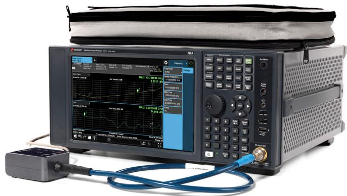  
Keysight NFA 让噪声系数测量变得更简单

# 噪声在通信系统中的重要性

在通信系统中，接收系统输出端的信噪比 (S/N) 是一个非常重要的指标。在存在噪声的情况下辨别或收听无线电信号通常有点困难。不过，解析音频信息这种能力很难量化，因为它取决于语言熟悉程度、疲劳程度、训练、经验和信息的性质等人为因素。噪声系数和灵敏度是可以测量的客观品质因素。噪声系数与灵敏度密切相关（参见术语表中的“灵敏度”）。在数字通信系统中，定量可靠性量度通常以比特误码率 (BER) 或接收的比特出现误码的概率表示。BER 与噪声系数呈非线性关系。例如，当信噪比逐渐下降时，BER 会在 1 和0 变得混淆的噪声电平附近突然上升。噪声系数显示系统是否健康，而 BER 则显示系统的死活。

图 1-1 显示了几种数字调制类型下的误码概率与载波噪声比的关系，从中可以看到，信噪比的变化只有几个 dB，而 BER 的变化有几个数量级。

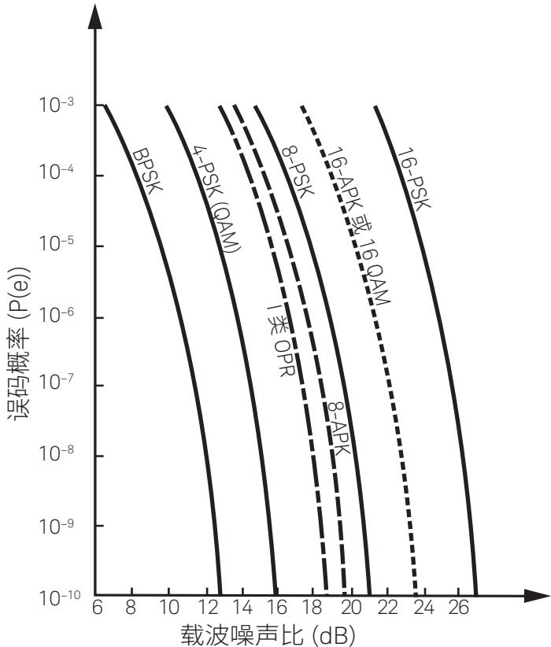  
图 1-1. 对于各种数字调制类型而言，误码概率 P(e) 由载噪比（C/N，可以理解为信噪比）决定。出自 Kamilo Feher 的 DIGITAL COMMUNICATIONS: MicrowaveApplications， $\circledcirc$ 1981，第 71 页。重印许可方：Prentice-Hall, Inc., EnglewoodClif fs, NJ

输出信噪比取决于两个因素：输入信噪比和噪声系数。在地面系统中，输入信噪比与发射功率、发射机天线增益、大气传输系数、大气温度、接收机天线增益和接收机噪声系数有关。降低接收机噪声系数对输出信噪比的影响与提高其他任何一个因素的影响相当。

在卫星系统中，噪声系数可能尤其重要。我们来看一个降低直播卫星 (DBS)系统接收机噪声系数的例子。还有一种改进接收机噪声系数的方式是增加发射机功率，不过，这种方式的实施成本可能比较高。更好的替代方案，就是大幅度提升接收机低噪声放大器 (LNA) 的性能。提升 LNA 的性能比增加发射机功率更容易。

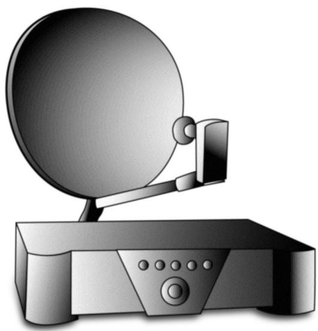

DBS 接收机

在卫星接收机生产线上，通过调整阻抗电平或谨慎地选择特定晶体管，可以很容易地将噪声系数降低 1 dB。噪声系数降低1 dB 的效果与天线直径增加 $40 \%$ 的效果大致相当。但是，增加天线直径可能会改变设计，显著提高天线和支撑结构的成本。

噪声有时候是发射机设计的一个重要参数。举个例子，如果在基站上使用线性宽带功率放大器，过多的宽带噪声会降低相邻信道的信噪比，并且会限制系统的有效性。可以测量出功率放大器的噪声系数，以便在安装到系统之前获知品质因数，从而确保噪声电平在可接受范围内。

# 噪声源

通过噪声测量表征的噪声，包括电气设备中普遍存在的自发波动。热噪声来源于传导电子和空穴因有限温度而产生的振动。一部分振动在相关频段内有频谱分量，并对信号产生噪声。热噪声产生的噪声谱在射频和微波频率上接近均匀。由热源输送到阻抗匹配负载的功率为 kTB 瓦，其中 k 为玻尔兹曼常数（ $\phantom { + } 1 . 3 8 \times 1 0 ^ { - 2 3 }$ 焦耳/K），T 为温度（单位：K），B 为系统的噪声带宽。可用功率与源阻抗无关。进入匹配负载的可用功率与带宽成正比，因此带宽提高一倍，传送至负载的功率也提高一倍。（见术语表中的“热噪声”。）

散粒噪声源于电流的量化性质（见术语表中的“散粒噪声”）。自然界发生的其他随机现象被量化后以散粒噪声的方式形成噪声。这样的例子包括半导体中空穴/电子对的产生和复合（G-R 噪声），以及发射机电流在晶体管基极到集电极之间的分配（分配噪声）。这类噪声的形成机制具有与热噪声相似的特性，即频谱基本保持均匀，在整个射频和微波频率范围内生成相等的功率密度。

电气器件中产生随机噪声的原因有很多。噪声表征通常指的是元器件中所有原因的综合效应。人们通常认为综合效应是由热噪声引起。器件具有特定噪声温度并不意味着该元器件就具有同样的物理温度，而仅仅意味着其噪声功率相当于该温度对应的热源。尽管噪声温度与物理温度并不直接对应，但可能存在一定的温度相关性。当器件冷却至环境温度以下时，可以实现非常低的噪声系数。

本应用指南中提到的噪声不包括人为干扰，尽管这种干扰在接收微弱信号时非常重要。本应用指南不涉及点火、火花产生的噪声，也不涉及意外拾取的杂散信号。本应用指南不涉及大气中的电风暴等不稳定扰动。这类噪声问题通常通过重新定位、滤波和适当屏蔽等技术手段解决。不过，这样的噪声源在这里都很重要，从某种意义上说，它们干扰了本文所探讨的自发噪声的测量。LNA 制造商可能很难测量噪声系数，因为附近通常有基站在他们用来进行敏感测量的频率上发射射频功率。考虑到这一点，噪声系数测量通常是在屏蔽室内完成。

# 噪声系数的概念

20 世纪 40 年代，Harold Friis[8] 将网络噪声系数 F 定义为输入端信噪比与输出端信噪功率比之比，这个最基础的噪声系数定义被广为接受。

$$
\mathsf { F } = \frac { \mathsf { S } _ { \mathrm { i } } / \mathsf { N } _ { \mathrm { i } } } { \mathsf { S } _ { \mathrm { o } } / \mathsf { N } _ { \mathrm { o } } }
$$

网络的噪声系数代表信号经过网络时信噪比的降低或退化。理想的放大器会将输入端的噪声与信号一同放大，从而在输入端和输出端保持相同的信噪比（输入噪声通常源自与地球表面温度或系统损耗相关的热噪声）。然而，现实中的放大器也会因自身元器件而额外增加一些噪声，导致信噪比下降。噪声系数低意味着网络增加的噪声非常小。噪声系数这个概念只适用于处理信号的网络（至少具有一个输入端口和一个输出端口）。本应用指南主要讨论双端口网络。尽管混频器一般有三个端口，但我们通常将其视同为双端口器件，因为其第三个端口连接了本地振荡器。

噪声系数不能表征什么呢，这可能也很值得一提。噪声系数不是单端口网络的质量因数，也不是终端或振荡器的质量因数。振荡器有自己的质量因数，如载噪比和相位噪声。但驱动混频器的本地振荡器边带产生的接收机噪声，可能会叠加至混频器中叠加的这些噪声会增大接收机的噪声系数。

噪声系数与调制或解调无关，也与调制格式以及调制器和解调器的保真度无关。因此，相较于用来指示 FM 接收机的灵敏度或数字通信的BER 的噪音消除概念，噪声系数这个指标更为普及。

噪声系数应当与增益分开考虑。一旦信号中增加了噪声，后续的增益会将信号和噪声一起放大，并且不会改变信噪比。

图 1-2(a) 显示了一个放大器输入端的情况示例。所示信号比噪底高40 dB：图 1-2(b) 显示了放大器输出端的情况。放大器的增益将信号提高了 20 dB，此外还将输入噪声电平提高了 20 dB，然后增加了自己的噪声。输出信号现在只比噪底高 30 dB。由于信噪比降低了 10 dB，因此放大器的噪声系数为 10 dB。

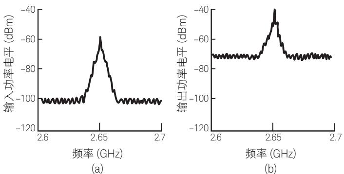  
图 1-2. 放大器输入端 (a) 和输出端 (b) 的典型信号和噪声电平与频率的关系。请注意，由于放大器电路增加了额外的噪声，因此噪声电平比信号电平上升得多一些。噪声电平的相对上升可以用放大器噪声系数表示。

请注意，如果输入信号电平再下降 5 dB（比本底噪声高 35 dB），那么输出信号电平也会下降 5 dB，噪声系数则仍为 10 dB。因此，噪声系数与输入信号电平无关。

接下来我们要探讨一种更细微的影响。网络的信噪比的下降取决于激励网络的信号源的温度。这一点可以通过计算噪声系数F 来证明，其中 $\mathsf { S } _ { \mathrm { i } }$ 和 $\mathsf { N } _ { \mathrm { i } }$ 表示待测器件 (DUT) 输入端可用的信号和噪声电平：

$$
\begin{array} { r l } & { \mathsf { F } = \frac { \mathsf { S } _ { 1 } / \mathsf { N } _ { \mathrm { i } } } { \mathsf { S } _ { \mathrm { s } } / \mathsf { N } _ { 0 } } } \\ & { = \frac { \mathsf { S } _ { / } / \mathsf { N } _ { \mathrm { i } } } { \mathsf { G S } _ { \mathrm { s } } / ( \mathsf { N } _ { \mathrm { a } } + \mathsf { G N } _ { \mathrm { i } } ) } } \\ & { = \frac { \mathsf { N } _ { \mathrm { a } } + \mathsf { G N } _ { \mathrm { i } } } { \mathsf { G N } _ { \mathrm { i } } } } \end{array}
$$

S 和 $\mathsf { N } _ { \mathrm { o } }$ 表示输出端的信号和噪声电平，N 为 DUT 增加的噪声，G 为 DUT 的增益。公式 (1-2) 展示了与输入端噪声 (N) 的相关性。输入噪声电平通常是来自信号源的热噪声，可以用 $\mathsf { k T } _ { 0 } \mathsf { B }$ 表示。Friis[8] 建议采用 $2 9 0 \mathsf { K }$ （用 ${ \sf T } _ { 0 }$ 表示）作为参考源的温度，相当于 $1 6 . 8 ^ { \circ } \mathrm { C }$ $( 6 2 . 3 ^ { \circ } \mathsf { F } )$ )。该温度接近于发射天线穿过大气层传送到接收天线的平均温度。

此外，功率谱密度 $\mathsf { k T } _ { 0 }$ 为偶数 $4 . 0 0 \times 1 0 ^ { - 2 1 }$ 瓦/赫兹带宽 (–174dBm/Hz)。IRE（IEEE 的前身）采用 $2 9 0 \mathsf { K }$ 作为确定噪声系数的标准温度[7]。公式 (1-2) 变为：

$$
\mathsf { F } = \mathrm { ~ \frac { \mathsf { N } _ { a } + \mathsf { k } \mathsf { T } _ { 0 } \mathsf { B } \mathsf { G } } { \mathsf { k } \mathsf { T } _ { 0 } \mathsf { B } \mathsf { G } } ~ }
$$

这是 IRE 采用的噪声系数定义。

噪声系数通常与频率有关，

但一般情况下与带宽无关（只要测量带宽窄到足以应付频率带来的变化）。公式 (1-2) 的噪声功率 $\Nu _ { \mathfrak { a } }$ 和 N 分别与带宽成正比。但是，公式 (1-2) 中分子的带宽与分母的带宽两相抵消，从而噪声系数与带宽无关。

总之，DUT 的噪声系数就是信号通过 DUT 时的信噪比衰减。用于确定该衰减的特定输入噪声电平与290 K信号源温度相关。只要DUT（输出功率与输入功率）保持线性，其噪声系数就与信号电平无关。

公式 (1-3) 是 IEEE 标准定义的噪声系数。根据该定义，当输入源温度为 290 K 时，噪声系数是总噪声功率输出与由于输入噪声而产生的噪声功率输出部分之比。

公式(1-3)中的量F通常被称为噪声系数，但它更常被称为噪声因数，在线性概念中有时被称为噪声系数。噪声系数的现代用法通常保留为数量 NF，以 dB 为单位表示：

$$
{ \mathsf { N F } } = 1 0 \log { \mathsf { F } }
$$

本应用指南的其余部分采用了这一惯例表述。

# 噪声系数和噪声温度

有效输入噪声温度 $( \top _ { \mathrm { e } } )$ 有时用于描述器件的噪声性能而非噪声系数 (NF)。卫星接收机中使用的器件通常用温度单位表示。T 是接入理想（无噪声）器件的源阻抗的等效温度，该器件会产生相同的加性噪声 $\Nu _ { \mathrm { a } }$ ，通常被定义为

$$
T _ { e } = \frac { N _ { a } } { k B }
$$

它可能与噪声因数 F 有关：

由于地球表面温度的原因，地面 VHF 和微波通信中的输入噪声电平通常接近噪声系数计算中使用的 $2 9 0 \mathsf { K }$ 参考温度。在这种情况下，噪声系数变化 3 dB，信噪比也会变化 3 dB。

在卫星接收机中，来自天线的噪声电平可能低得多，受旁瓣辐射和背景太空温度的限制，通常低于 100 K。此类情况下，接收机噪声系数变化 3 dB 所导致的信噪比变化可能远大于 3dB。虽然系统性能可以使用噪声系数计算而不会出现任何错误（290 K 参考温度不必对应于实际温度），但系统设计人员可能更愿意使用 T 作为系统参数。

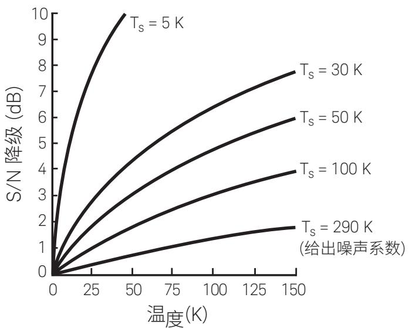  
图 1-3. 在源阻抗的不同温度值，器件信噪比相对于 T 的关系下降。噪声系数是以290 K 为源温度界定的值。

# 2. 双端口网络的噪声特性

# 多级系统的噪声系数

第 1 章中涵盖的噪声系数定义可应用于单个元器件（如单晶体管放大器），也可应用于完整系统（如接收机）。如果已知系统元器件的单个噪声系数和增益，我们可以计算出系统的总噪声系数。为了得到系统中每个元器件的噪声系数，必须先求出每一级增加的内部噪声 $\Nu _ { \mathfrak { a } }$ 。增益也必须已知。第 3 章“噪声系数的测量”介绍了用于确定噪声和增益的实际方法。在这里我们要探讨各个元器件与系统之间的基本关系。

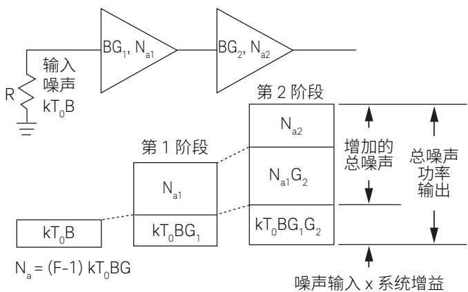  
图 2-1. 第二级贡献的影响。

在图 2-1 所示的两级中，输出噪声包括由被两个增益 $( \mathsf { G } _ { 1 } , \mathsf { G } _ { 2 } )$ ）放大的 $\mathsf { k T } _ { 0 } \mathsf { B }$ 源噪声、由第二级增益 $( \mathsf { G } _ { 2 } )$ 放大的第一级放大器输出噪声 $\mathsf { N a } _ { 1 }$ ，以及第二级放大器的输出噪声 $\mathsf { N a } _ { 2 } ,$ 。噪声功率贡献也可以加入进去，因为它们不相关。用公式 (1-3) 来表示单个放大器的噪声贡献，输出噪声可以用它们的噪声因数 F 表示。

在已知输出噪声的情况下，我们可以用公式 (1-1) 来计算两个放大器的组合噪声因数。这是两级系统示例的总体系统噪声系数。 $( \mathsf { F } _ { 2 } - 1 ) / \mathsf { G } _ { 1 }$ 的值通常被称为第二级贡献。可以看出，只要第一级增益大，第二级贡献就会小。这也是前置放大器增益是接收机设计中的一个重要参数的原因。

$$
F _ { \mathrm { s y s } } = F _ { 1 } + \frac { F _ { 2 } - 1 } { G _ { 1 } }
$$

$$
N _ { _ 0 } = k { \sf T } _ { _ 0 } \mathsf { B G } _ { _ 1 } \mathsf { G } _ { _ 2 } \left[ \mathsf { F } _ { _ 1 } + \frac { \mathsf { F } _ { _ 2 } - 1 } { \mathsf { G } _ { _ 1 } } \right]
$$

如果已知增益和系统总噪声因数，我们可以通过公式 (2-2) 计算出 $\mathsf { F } _ { \tau }$ 。这是校正噪声测量的基础，我们将在下一章讨论。

这个公式可以扩展至 $\mathsf { n }$ 级级联器件，表达如下：

$$
\boldsymbol { \mathsf { F } } _ { \mathrm { s y s } } = \boldsymbol { \mathsf { F } } _ { 1 } + \frac { \boldsymbol { \mathsf { F } } _ { 2 } - 1 } { \boldsymbol { \mathsf { G } } _ { 1 } } + \frac { \boldsymbol { \mathsf { F } } _ { 3 } - 1 } { \boldsymbol { \mathsf { G } } _ { 1 } \boldsymbol { \mathsf { G } } _ { 2 } } + \ldots \underbrace { \boldsymbol { \mathsf { F } } _ { n } - 1 } _ { \boldsymbol { \mathsf { G } } _ { 1 } \boldsymbol { \mathsf { G } } _ { 2 } \ldots \boldsymbol { \mathsf { G } } _ { n - 1 } }
$$

公式 (2-3) 通常称为级联噪声公式。

# 增益与失配

# 噪声参数

器件增益是噪声计算中的一个重要参数。在这类计算中使用 $\mathsf { k T } _ { 0 } \mathsf { B }$ 输入功率时，它就是可用功率，也就是可以提供给匹配负载的最大功率。如果器件的输入失配较大（这对于低噪声放大器来说并不罕见），那么传输至器件的实际功率会更小。如果将器件的增益定义为传输至负载的实际功率与信号源的最大可用功率之比，我们就可以忽略器件输入端的失配损耗，因为增益的定义中已经考虑了该损耗。该增益称为换能器增益 $\mathsf { G } _ { { \sf t } ^ { \circ } }$ 。不过，在级联器件时，如果器件的输入阻抗与负载阻抗不同，则会出现失配错误。在这种情况下，级联的系列器件总增益与增益的乘积不相等。

可用增益 $( \mathsf { G } _ { \mathsf { a } } )$ 通常作为晶体管参数给出，它是在指定的源导纳$( \mathsf { Y } _ { \mathsf { s } } )$ 驱动器件、且输出与负载相匹配时所产生的增益。设计放大器时经常会用到可用增益。有关增益的不同定义的详细描述，参见术语表。

通常来说，插入增益 $\left( \mathsf { G } _ { \mathrm { i } } \right)$ 或前向传输系数 $( \mathsf { S } _ { 2 1 } ) ^ { 2 }$ 是在 $5 0 \Omega$ 系统中指定或测得的增益量。如果测量系统的反射系数较低，并且器件具有较好的输出匹配，那么级联噪声系数公式 (2-3)应用于实际系统时几乎不会出错。如果器件输出匹配不佳或测量系统存在严重失配，那么实际系统性能与计算得出的性能之间会出现偏差。举个例子，如果第一级输出阻抗与表征第二级噪声系数时使用的 50$\Omega$ 源阻抗不同，那么在第二级产生的噪声可能会不一样。幸好第一级增益会降低第二级噪声贡献，因此，在许多应用中涉及第二级的误差会很小。如果第一级的增益较低 $( \mathsf { G } ^ { 2 } \mathsf { F } _ { 2 } )$ ，那么第二级误差可能会相当大。全面分析噪声计算中的失配效应比较花时间，通常需要了解源阻抗对噪声系数的影响。该效应以及增益失配效应将在下一节（噪声参数）中讨论。正是由于噪声系数受到的这种影响，S 参数校正在消除失配引起的误差方面并不像看起来那样有用。[4]

噪声系数原则上是系统中实际噪声的简化模式。每一级都有一个理论上的噪声要素。大多数实际的放大设备（如晶体管）可能存在多个噪声来源，如热噪声、散粒噪声和分配噪声。源阻抗对这类噪声的产生过程影响可能非常复杂。通过噪声系数测量得到的噪声系数受噪声源匹配和测量仪表匹配影响。噪声源是DUT的源阻抗，而 DUT 则是测量仪器的源阻抗。器件在其运行环境中的实际噪声系数性能由其它系统元器件的匹配情况决定。

设计低噪声放大器时，需要在级增益和相应的噪声系数之间做出权衡。做出这些决策需要了解有源器件的增益和噪声系数是如何随着源阻抗或导纳发生变化的。最小噪声系数不一定出现在系统阻抗 (Z ) 处或增益达到最大的共轭匹配阻抗处。

要想完全了解系统中失配的影响，我们需要表征被测器件 (DUT)的两个指标，其一是噪声系数，其二是增益。虽然S参数校正可用于计算完美匹配系统中的可用增益，但不能用于找出最佳噪声系数。噪声参数表征使用特殊调谐器向 DUT 呈现不同的复阻抗。[29]

噪声因数对调谐器呈现的源阻抗的依赖性可用下式表示

$$
F = F _ { _ { \mathrm { m i n } } } + \frac { 4 \mathsf { R } _ { \mathrm { n } } } { Z _ { \mathrm { o } } } \bigg ( \frac { \big | \mathsf { \bar { I } } _ { \mathrm { o p t } } - \mathsf { \bar { I } } _ { \mathrm { s } } \big | ^ { 2 } } { \big | \uparrow + \mathsf { \bar { I } } _ { \mathrm { o p t } } \big | ^ { 2 } ( \uparrow - \big | \mathsf { \bar { I } } _ { \mathrm { s } } \big | ^ { 2 } ) } \bigg )
$$

其中，Γ 是得出噪声因数 (F) 的源反射系数。在上式中， $\digamma _ { \mathrm { m i n } }$ 是 Γ$= \Gamma _ { \mathrm { { o o t } } }$ 时器件的最小噪声因数。 $\mathsf { R } _ { \mathsf { n } }$ 是噪声电阻（噪声系数对源导纳变化的灵敏度）。 $\mathsf { F } _ { \mathsf { m i n } } .$ 、 $\mathsf { R } _ { \mathsf { n } }$ 和 $\Gamma _ { \mathrm { { o p t } } }$ 通常被称为噪声参数，噪声表征就是指根据它们做出判断。将 Γ 绘制到一组恒定噪声因数 (F)的史密斯图上，就得到了噪声圈。噪声圈可以方便地显示源阻抗与噪声系数之间的复杂关系。

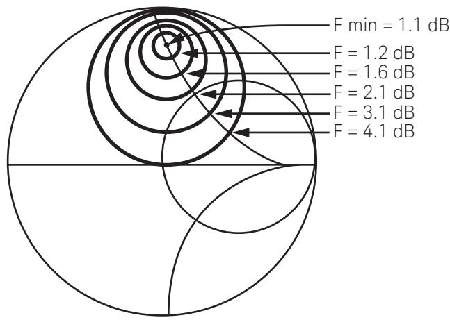  
图 2-2. 噪声圈

如果设备是由指定的源阻抗驱动，它提供的可用增益 $( \mathsf { G } _ { \mathsf { a } } )$ 则可以使用公式 (2-5) 基于设备的 S 参数 [35、40] 和源反射系数 (Γ) 计算得出。我们通常使用网络分析仪测量 S 参数。

$$
\begin{array} { r l } { \mathsf { G } _ { \mathrm { a } } = } & { \frac { ( 1 - \left| \mathsf { r } _ { \mathrm { s } } \right| ^ { 2 } ) \left| \mathsf { S } _ { 2 1 } \right| ^ { 2 } } { \left| \mathsf { 1 } - \mathsf { S } _ { 1 1 } \mathsf { r } _ { \mathrm { s } } \right| ^ { 2 } \left( 1 - \left| \mathsf { S } _ { 2 2 } \right. + \left. \frac { \mathsf { S } _ { 1 2 } \mathsf { S } _ { 2 1 } \mathsf { T } _ { \mathrm { s } } } { 1 \left. - \mathsf { S } _ { 1 1 } \mathsf { T } _ { \mathrm { s } } \right| ^ { 2 }  } \right| ^ { 2 } } } \en\right)d{array} \end{array}
$$

将源反射系数 $( \Gamma _ { \varsigma } )$ 绘制到与一组固定增益对应的史密斯图上，即可得到增益圈。增益圈可以方便地显示源阻抗与增益之间的关系。

# 带宽的影响

尽管系统带宽对于许多系统来说比较重要，并且涉及解调信号的实际信噪比计算，但噪声系数与设备带宽无关。在执行噪声测量时，我们通常会假设待测设备的幅频特性在测量带宽上保持恒定。这意味着噪声测量带宽应小于设备带宽。如若不然，则会引入误差。[34] 高性能 Keysight NFA X 系列噪声系数分析仪与基于频谱分析仪的测量系统一样具有可变带宽，以便测量窄带设备。

通常情况下，一个系统（如接收机）中的带宽定义要素是中频(IF)或检波器。它通常具有比射频电路窄得多的带宽。在这种情况下，噪声系数是描述射频电路噪声性能的有效参数。在射频电路带宽低于IF或检波器带宽的异常情况下，噪声系数仍然可以用作供比较的品质因数，不过完整地分析系统信噪比需要输入带宽作为参数。

# 3. 噪声系数的测量

# 噪声功率线性度

大多数噪声系数测量的基础都取决于线性双端口设备的基本特性，也就是噪声线性度。如图 3-1 所示，设备输出的噪声功率与输入噪声功率或温度呈线性关系。如果已知该特性的斜率和一个参考点，我们就可以确定输入功率在无噪声情况下对应的输出功率 $( \mathsf { N } _ { \mathsf { a } } )$ 。如第 1 章所述，我们可以基于 N 计算出噪声系数或有效输入噪声温度。由于需要线性度，因此在进行噪声系数测量时必须禁用自动增益控制 (AGC) 电路。

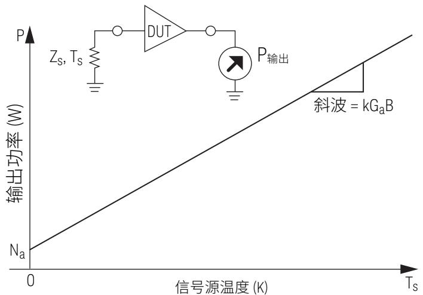  
图 3-1. 线性双端口设备的直线功率输出与源温度特性的关系。对于绝对零温度的源阻抗，功率输出只包括 DUT 增加的噪声 N 。对于其他源温度，功率输出还需加上由 DUT 增益特性放大的源热噪声。

# 噪声源

确定噪声斜率的一种方法是应用两个不同电平的输入噪声，测量输出功率的变化。噪声源就是提供这两个已知噪声电平的设备。常见的噪声源包含一个特殊的低电容二极管。当反向偏置进入恒流式雪崩击穿时，该二极管会产生噪声[5]。Keysight SNS 系列等精密噪声源具有输出衰减器，可以提供低 SWR 来尽量减少测量中的失配误差。如果通断状态下的阻抗不同，则可能会给噪声系数测量带来错误 [23]。N4000A 噪声源具有较大的衰减值，可以将这种影响控制到最低。

当二极管偏置时，二极管中产生的雪崩噪声会导致输出噪声超过kT B [11、12、13、15、20、21]；如果没有偏置，输出就是衰减器中产生的热噪声 $( \mathsf { k } \mathsf { T } _ { \mathtt { c } } \mathsf { B } )$ 。这些电平有时被称为 Th 和 Tc，分别对应热和冷。N4001A 在开启时产生的噪声电平大约等于 10000 K，在关闭时则为 290 K。是德科技提供 50 GHz 二极管噪声源。346C 选件K40 具有高达 40 GHz 的出色匹配。

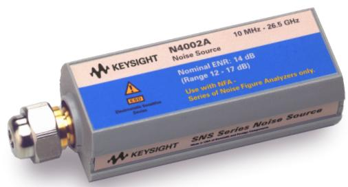  
SNS 系列噪声源

为了进行噪声系数测量，噪声源必须具有经过校准的输出噪声电平，该电平用过量噪声比 (ENR) 表示。特定的ENR 校准信息随噪声源一起提供。就 SNS 系列而言，这些信息保存在非易失性存储器中。其他噪声源提供数据的方式较为不便。 $\mathsf { E N R } _ { \mathrm { d B } }$ 是一个比值，即 T 与 T 之差除以 $2 9 0 \mathsf { K }$ 得出（单位：dB）。请注意，0 dBENR 噪声源在开启和关闭状态下会有 $2 9 0 \mathsf { K }$ 的温度差异。ENR 并不是通常被认为的相对于 kTB 的导通噪声。

$$
\mathsf { E N R } _ { \mathrm { d B } } = 1 0 \log \Big ( \frac { \mathsf { T } _ { \mathrm { h } } - \mathsf { T } _ { \mathrm { c } } } { \mathsf { T } _ { \mathrm { 0 } } } \Big )
$$

经过校准的 T 在公式 (3-1) 中取值为 290 K。如果在不同的物理温度下使用噪声源，必须对测量进行补偿。SNS 系列噪声源包含一个温度传感器，是德科技分析仪可以读取该传感器的值。本章下一节将介绍温度补偿。

很多噪声系数计算使用了 ENR 的线性形式。

噪声源可以使用传递标准噪声源（校准记录可追溯至顶级国家标准实验室）或主要物理标准（如热/冷负载）进行校准。大多数噪声源将提供 ENR 特性与频率的关系。

冷/热负载在某些特殊应用中可充当噪声源。两个负载最好保存在恒定温度下，以便维持良好的测量精度。有一种方法是将一个负载浸入温度为 77 K 的液氮中，另一个负载则在室温或温度受控的烘箱中保存。相较于噪声二极管源，这种方法具有相对较小的温度差，切换至不同温度负载所导致的潜在 SWR 变化也比较小，因此通常仅限于校准实验室和毫米波用户使用。

嵌入波导结构中的气体放电管会因等离子体的动能而产生噪声。传统上它们被用作毫米波噪声源，但现在基本上已经被频率低于50 GHz 的固态噪声二极管取代。噪声二极管使用起来更简单，是更稳定的噪声源。噪声二极管通常是同轴器件，但我们可以使用集成的精密型波导适配器来提供波导输出。

# Y 因子法

无论是手动执行测量还是在噪声系数分析仪内部自动执行测量，大多数噪声系数测量都会采用 Y 因子法这一基本方法。该方法使用噪声源确定 DUT 内部的噪声，从而确定噪声系数或有效输入噪声温度。

将噪声源连接至 DUT 后，我们可以测量噪声源开启和关闭 $( \mathsf { N } _ { 2 }$ 和N ）时所对应的输出功率。这两个功率之比即为 Y 因子。用于测量的功率检测器可以是功率计或频谱分析仪，如果是使用噪声系数计和分析仪进行测量的话，则可能是特殊的内部功率检测器。相对电平精度非常重要。现代噪声系数分析仪的优点之一是，内部功率检测器的线性度非常高，可以非常精确地测量电平变化。测量装置的绝对功率电平准确度并不重要，因为需要测量的是比率。

$$
\ Y = \frac { { \mathsf N } _ { 2 } } { { \mathsf N } _ { 1 } }
$$

该比率有时以 dB 为单位进行测量，在这种情况下：

$$
\textsf { Y } = 1 0 ^ { \frac { \Upsilon _ { \mathrm { d B } } } { 1 0 } }
$$

Y 因子和 ENR 可用于确定 DUT 的噪声斜率，如图 3-1 所示。由于经过校准的噪声源 ENR 代表输入噪声的参考电平，我们可以推导出计算 DUT 内部噪声 $( \mathsf { N } _ { \mathsf { a } } )$ 的公式。现代噪声系数分析仪会通过调制开/关状态下的噪声源并应用内部计算来自动做出判断。

$$
N _ { \mathrm { a } } = \mathrm { k T } _ { 0 } \mathrm { B G } _ { 1 } \left( \frac { \mathsf { E N R } } { \mathsf { Y } - 1 } - 1 \right)
$$

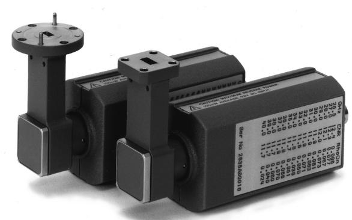

由此，我们可以推导出一个非常简单的噪声因数表达式。产生的噪声因数是系统总噪声因数 $( \mathsf { F } _ { \mathrm { s y s } } )$ 。系统噪声因数包含系统中每一个部件贡献的噪声。在这种情况下，测量仪器产生的噪声被视为第二级贡献。如果 DUT 增益较大 $( \mathsf { G } _ { 1 } { \circ } _ { \mathrm { 2 } } \mathsf { ) }$ ，那么第二级的噪声贡献会很小。如果已知第二级的噪声系数和 DUT 的增益，则可以将第二级贡献从噪声系数计算中去除。这一部分内容将在关于校正噪声系数和增益的章节中介绍。请注意，Fsys的计算无需用到器件增益。

$$
F _ { _ { \mathrm { S Y S } } } = \frac { \mathsf { E N R } } { \mathsf { Y } - \mathsf { 1 } }
$$

当噪声系数远高于 ENR 时，器件噪声可能会掩盖噪声源输出。在这种情况下，Y 因子将非常接近 1。精确测量小比率可能比较困难。当噪声系数比噪声源 ENR 高出 10 dB 以上时，通常不使用Y因子法，具体情况取决于测量仪表。

该公式可以进行调整，以校正噪声源冷温度 (T) 不是 $2 9 0 \mathsf { K }$ 参考温度 $( \top _ { 0 } )$ 的条件。

$$
F _ { \mathrm { s y s } } = \ \frac { \mathsf { E N R } - \mathsf { Y } \left( \frac { \top _ { \mathrm { c } } } { \top _ { 0 } } - 1 \right) } { \mathsf { Y } - 1 }
$$

这个常用公式的假设条件是，在使用热负载和冷负载的情况下， $\top _ { \mathfrak { n } }$ 不受 T 变化的影响。就固态噪声源而言， $\top _ { \mathfrak { n } }$ 可能会受到${ \sf T } _ { \mathbb { c } }$ 变化的影响。由于物理噪声源处于 T 的温度，因此无论噪声源是开还是关，T 引起的内部衰减器噪声都会加入进来。在这种情况下，最好假设开、关状态下的噪声变化保持恒定 (T -T)。当 T低于 10 倍 T 时，该区别对于低 ENR 噪声源最重要。针对这种情况，我们可以使用另一个公式。

# 信号发生器两倍功率法

在噪声源出现之前，这种方法很常用。对于 Y 因子非常小且难以准确测量的高噪声系数器件，这种方法仍然特别有用。首先，输出功率是在器件输入端接入温度约为 290 K 的负载时测量的。然后，连接信号发生器，在测量带宽内提供信号。调整发生器输出功率，使输出功率增加 3 dB。如果已知发生器的功率电平和测量带宽，我们可以计算出噪声因数。而无需知道DUT 增益是多少。

这种方法的准确度受几个因素限制。

$$
F _ { \mathrm { s y s } } = \ { \frac { \mathsf { P } _ { \mathsf { g e n } } } { { \mathsf { k } } \mathsf { T } _ { 0 } { \mathsf { B } } } }
$$

我们必须要知道功率测量器件的噪声带宽，这可能需要用到网络分析仪。噪声带宽 (B) 是计算得出的等效带宽，其频谱呈矩形“平顶”状，增益带宽乘积与实际滤波器形状相同。输出功率必须在测量真实功率的器件上测得，因为同时存在噪声与CW 信号。热式功率计能够非常准确地测量真实功率，但可能需要大量放大才能读取低噪声电平，并且需要用到界定带宽的滤波器。频谱分析仪具有良好的灵敏度和带宽，但检波器可能会对 CW 信号和噪声做出不同的响应。功率检波器不需要绝对电平准确度，因为此时在测量比率。

# 直接噪声测量法

该方法也适用于高噪声系数器件。器件的输出功率在 290 K 左右的温度下使用输入端接测得。如果已知器件增益和测量系统噪声带宽，就可以确定噪声因数。

$$
\mathsf { F } _ { \mathrm { s y s } } = \frac { \mathsf { N } _ { \circ } } { \mathsf { k T } _ { \circ } \mathsf { B G } }
$$

再次说明一下，如果使用该方法，噪声带宽 (B) 必须为已知，且功率测量器件要有非常高的灵敏度。与两倍功率法不同的是，DUT 增益必须为已知，且功率检波器必须具有绝对的电平准确度。

# 校正后的噪声系数和增益

之前的测量方法用于测量系统总噪声因数 $( \mathsf { F } _ { \mathrm { s y s } } )$ ，其中包括测量系统。而通常需要的是 DUT 噪声系数。从级联噪声系数公式可以看出，如果 DUT 增益大，则测量系统对测量的影响小。高增益DUT 的噪声系数可以采用前面介绍的方法直接测量。在测量低增益 DUT 或者是需要极高的准确度时，如果我们知道 DUT 的增益和系统的噪声系数，可以应用校正措施。使用公式 (2-2) 并重写以求出 $\mathsf { F } _ { \tau }$ 的解，得出实际 DUT 噪声因数的公式。

$$
F _ { _ 1 } = F _ { _ { \mathrm { s y s } } } - \frac { F _ { _ 2 } - 1 } { G _ { _ 1 } }
$$

DUT 的增益和测量系统噪声因数 $( \mathsf { F } _ { 2 } )$ 可以通过额外的噪声源测量确定。这一步骤称为系统校准。对于噪声系数分析仪，我们通常在连接 DUT 之前进行该校准，以便后续测量都可以使用校正值，并且可以显示校正后的噪声系数。确定增益和校正噪声系数而进行的必要计算均在内部自动执行。如果使用替代仪器进行手动测量，可按如下步骤完成校准噪声系数测量：

1. 将噪声源直接连接到测量系统，测量与噪声源“开”和“关”状态对应的噪声功率电平。 $\mathsf { N } _ { 2 }$ 和 $\mathsf { N } _ { \uparrow }$ 这两个电平可用于通过 Y 因子法计算测量系统的噪声因数 $( \mathsf { F } _ { 2 } )$ 。

2. 将 DUT 接入系统。测量噪声源在开启和关闭状态下的噪声电平 $\mathsf { N } _ { 2 }$ 和 $\mathsf { N } _ { \uparrow }$ 。DUT 增益可以用噪声电平值计算得出。

$$
\mathsf { G } _ { 1 } = \mathrm { ~ \frac { N _ { 2 } ^ { \ell _ { 1 } } - N _ { 1 } ^ { \ell _ { 1 } } } { N _ { 2 } ^ { \ell _ { 2 } } - N _ { 1 } ^ { \ell _ { 1 } } } ~ }
$$

增益通常以 dB 表示：

3. 将 Y 因子法应用于值 $\mathsf { N } _ { 2 } ^ { \mathsf { \Gamma } }$ 和 ${ \sf N } _ { 1 } ^ { 1 }$ ，计算出系统总噪声因数 $( \mathsf { F } _ { \mathrm { s y s } } )$

4. DUT 噪声因数 (F ) 可以用公式 (3-11) 计算。DUT 噪声系数为10logF1。

# 抖动

我们可以将噪声视为一系列随机事件，在这种情况下是电脉冲。测量噪声的目的都是为了确定器件输出端的平均噪声电平。经过适当的校正之后，这些电平可用于计算器件的实际噪声系数。从理论上来说，找出真实平均噪声电平所需的时间是无限的。但在实际操作中，我们是在某个有限的时间段内取平均值。测得的平均值与真实平均值之间的差异会发生波动，导致重复性误差。

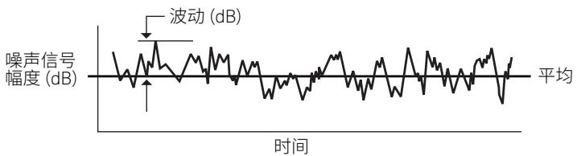  
图 3-2. 噪声抖动

如果波动较小，偏差与 ${ 1 } / { \sqrt { \mathrm { ( f ) } } }$ 成正比，平均时间段越长，得到的平均值就越好。因为平均值包含了更多事件，所以更接近真实平均值。波动也与 $\harpoonleft$ 成正比。测量带宽越大，得到的平均值越好，因为大带宽中每单位时间发生的噪声事件要多一些，平均值也就包含更多事件。一般情况下，我们应当使用尽可能宽但又不超过 DUT 的带宽来测量噪声系数。

# 变频器

接收机和混频器之类的变频器通常用于将射频频段转换为中频频段。虽然本应用指南中所讨论的噪声系数关系适用于变频器和非变频器，但这类器件的某些附加特性可能会影响噪声系数的测量。除了使用变频器这样的 DUT，噪声测量系统有时也使用混频方式来扩展测量频率范围。

# 损耗

放大器通常具有与之相关的增益，而无源混频器则有损耗。计算噪声系数的公式仍然适用，但使用的线性增益值将小于1。通过应用级联噪声系数公式，我们可以看出其中的一点：第二级噪声贡献可能相当之大（参见公式2-2）。另一个是无源混频器，如果使用 Y 因子技术测量，由于其高噪声系数，Y 因子可能很小。这可能会增加测量不确定度。高 ENR 噪声源可用于提供大一点的 Y因子。

# 本振噪声

接收机和混频器具有可能存在噪声的本振 (LO) 信号。该噪声可以在混频器中被转换至 IF 频段，成为系统噪声系数的额外贡献。这种影响的幅度变化很大，具体取决于特定的混频器类型和 LO 中的噪声大小。定频 LO 系统中的这些噪声可以使用混频器 LO 端口上的带通滤波器消除。滤波器在通过 $^ \dag _ { { \ L } \mathrm { { 0 } } }$ 的同时，抑制 $\mathrm { f } _ { \lfloor 0 } { + } / -$ $\boldsymbol { \mathsf { f } } _ { \mathsf { I F } }$ 、 $\boldsymbol { \mathsf { f } } _ { \mathsf { I F } }$ 和 $\mathsf { f } _ { \mathsf { R F } }$ 处的噪声，基本上可以消除该噪声。如果 LO 噪声电平非常高，也可能存在更高阶的噪声转换。可以采用低通滤波器来防止 LO 频率谐波处的噪声转换。

# LO 泄漏

混频器或转换器的输出端 (IF) 可能会出现残余 LO 信号。这种信号的出现一般与 DUT 的噪声性能无关，在用于预期应用时可能是可接受的。进行噪声系数测量时，该 LO 信号可能会使噪声测量仪器过载或产生其他杂散混频产物。如果测量系统的输入端有宽带放大器或其他未滤波电路，很可能会有问题。我们通常可以在仪表输入端添加一个滤波器，从而在通过 IF 时滤除 LO 信号。

# 不需要的响应

有时候，所需的 RF 频段并非唯一可以转换为 IF 的频段。如果除了所需的射频信号之外，射频端口处还存在不想要的频率，则可能发生不想要的频段转换。其中包括：镜像响应 $( \mathsf { f } _ { _ { \mathsf { L O } } } + \mathsf { f } _ { _ { \mathsf { I F } } }$ 或 $\mathsf { f } _ { \mathsf { L 0 } } -$ $\boldsymbol { \mathsf { f } } _ { \mathsf { | F } }$ ，取决于转换器）、谐波响应（ $( 2 \mathsf { f } _ { \mathsf { L 0 } } \pm \mathsf { f } _ { \mathsf { l } \mathsf { F } }$ 、 $3 \mathsf { f } _ { \mathsf { L 0 } } \pm \mathsf { f } _ { \mathsf { I } \mathsf { F } }$ 等）、杂散响应和 IF 馈通响应。由于存在内部滤波，接收机中的这些响应通常可以忽略不计。对于许多其他器件（特别是混频器），可能会出现一种或多种响应，并且可能会将额外的噪声转换至中频频段。

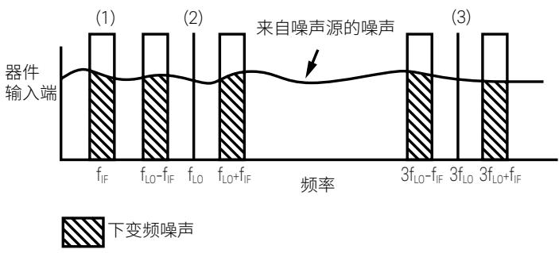  
图3-3，借助混频器和转换器可能实现的噪声转换机制。(1) IF 馈通响应，(2) 双边带响应，(3) 谐波响应。

具有两个主要响应 $( \mathsf { f } _ { _ { \mathsf { L O } } } + \mathsf { f } _ { _ { \mathsf { I F } } }$ 和 $\mathsf { f } _ { \mathsf { L } 0 } - \mathsf { f } _ { \mathsf { I } \mathsf { F } } )$ ）的混频器通常称为双边带(DSB) 混频器，其中 $\mathsf { f } _ { \mathsf { L } 0 } + \mathsf { f } _ { \mathsf { R } \mathsf { F } }$ 为上边带 (USB)， $\mathsf { f } _ { _ { \lfloor 0 } } - \mathsf { f } _ { _ { \mathsf { F } } }$ 为下边带(LSB)。它们将两个频段内的噪声转换至中频频段。如果噪声测量系统中包含这样的混频器，除非应用通常为 $+ 3 { \mathrm { d } } \mathsf { B }$ 的校正，否则二次响应将给噪声系数测量造成误差。最好是在射频端口处使用滤波来消除二次响应，以便进行单边带 (SSB) 测量。

如果 DUT 是 DSB 混频器，我们可以在测量噪声系数时进行选择。用户通常希望测量等效 SSB 噪声系数。在没有 LO 噪声的无源混频器中，等效 SSB 噪声系数的值通常接近使用 CW 信号测得的转换损耗。该测量可以使用两种方法进行：使用输入滤波器或者是应用 $^ { + 3 }$ dB 校正。如果要进行精密的测量，我们必须考虑这些方法对准确度的影响。输入滤波器会增加需要校正的损耗，而$^ { + 3 }$ dB 校正系数假设 USB 与 LSB 的响应相等。

噪声接收机（如辐射计和辐射传感器）中使用的转换器通常设计为利用两种主要响应，此时它需要知道 DSB 噪声系数。在这种情况下，我们不使用校正或输入滤波器；测量得到的噪声系数将以DSB 形式体现。

# 噪声系数测量仪器

# 噪声系数分析仪

噪声系数分析仪是噪声系数测量  
专用解决方案的代表。最基础的噪声系数分析仪包括一个具有准确功率检波器的接收机和  
一个为噪声源供电的电路。它提供 ENR 输入，并显示与其调谐到的频率对应的  
噪声系数值。噪声系数分析仪  
在内部使用 Y 因子法计算噪声系数。

噪声系数分析仪允许显示扫频噪声系数和增益以及游标和限值线等相关特性。

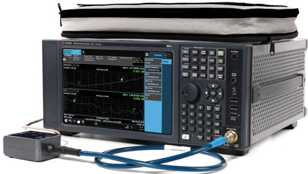

NFA 噪声系数分析仪

# 信号/频谱分析仪

信号/频谱分析仪通常用于测量噪声系数，  
因为它们已经包含在执行各种任务的  
众多射频和微波生产设施的  
测试台架中。它们可以配合软件和控制器，  
任选一种本应用指南中介绍过的方法来测量  
噪声系数。它们尤其适用于  
利用信号发生器或直接功率测量方法  
测量高噪声系数器件。借助噪声系数测量应用软件，它们能够将因所用噪声源的性能导致的不确定度降低到可以忽略的程度。可变分辨率带宽允许对窄带器件进行测量。

信号分析仪/频谱分析仪的一大优势是其多功能性。通常情况下，我们可以利用测量应用软件来针对特定通信标准进行测量。

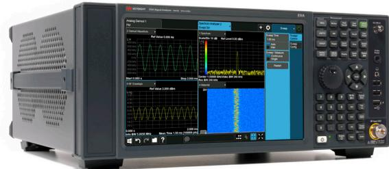  
EXA X 系列信号分析仪

# 网络分析仪

网络分析仪与频谱分析仪一样，都是常见的多功能仪器。它们不止可用于常规的网络测量，还可以用于噪声系数测量。它们的优点在于可以胜任通常与器件相关的其他测量，例如增益和匹配测量。由于网络测量通常使用相同的内部接收机架构完成，因此在应用于噪声系数测量时可能存在某些性能局限。接收机通常为双边带 (DSB)型，噪声系数是在两个频率上实际测得，并且进行了内部校正。使用大带宽进行测量时，如果该频率范围内的器件噪声系数或增益不恒定，则可能会导致误差。使用窄带宽测量窄带器件时，上、下边带之间未使用的频谱对测量值没有影响，需要通过延长测量时间来减少抖动（参见本章的“抖动”）。

# 网络分析仪能够测量

器件的 S 参数。人们认为 S 参数数据可以通过提供失配校正来降低噪声系数测量的不确定度。在理想的情况下，这种失配校正能为器件提供更准确的增益测量，以便精准地去除第二级噪声贡献。但是，失配还会影响第二级中噪声的产生。如果不知道器件的噪声参数，就无法对其进行校正。当噪声源与 DUT 输入端之间存在失配时，器件的输入端会发生相同的情况。（参见第2章的“噪声参数”）[4]。网络分析仪本身不提供噪声参数的测量。除了网络分析仪之外，测量噪声参数通常还需要用到调谐器和软件。这样一套测量系统可能既复杂又昂贵。网络分析仪中的误差校正主要有利于增益测量和可用增益的计算。

# 噪声参数测试仪

噪声参数测试仪通常配合软件、矢量网络分析仪和噪声分析仪一起使用，从而进行一系列测量，以便确定器件的噪声参数[29]（参见第 2 章的“噪声参数”）。然后，我们可以使用噪声参数来计算最小器件噪声系数、最佳源阻抗以及源阻抗对噪声系数的影响。测试仪具有一个可调节的调谐器，用于向 DUT 提供各种源阻抗。内部网络向待测的半导体器件提供偏置。将噪声源连接到测试仪上，以便在不同的源阻抗下测量噪声系数。相应的源阻抗采用网络分析仪进行测量。根据这些数据，我们可以计算出器件的完整噪声参数。一般情况下，我们还会测量完整的器件 S 参数，以便确定增益参数。由于涉及的测量种类繁多，完整地测量器件的噪声参数要比常规噪声系数测量慢很多，但能够得到有用的设计参数。低噪声晶体管的技术参数中通常会提供噪声参数。我们通常不会在用于匹配良好的 50（或 75）Ω 系统的元器件和组件上测量噪声参数，因为源阻抗是在应用中定义的。

# 功率计和真有效值电压表

功率计和真有效值电压表是基本的电平测量设备，可以采用本应用指南所介绍的任一种方法来测量噪声系数，再辅以必要的人工或计算机计算。作为宽带设备，它们需要滤波器来将带宽限制到不超过 DUT 带宽。这种滤波器通常具有固定的频率，并且只允许在该频率进行测量。测量接收机噪声系数最常用到的仪器是功率计，其中的接收机具有固定的中频频率和较大的增益。功率计和电压表的灵敏度一般不佳，但是接收机可以提供足够的增益来进行测量。如果在功率计前面额外增加增益以提高灵敏度，应当注意避免温度漂移和振荡。

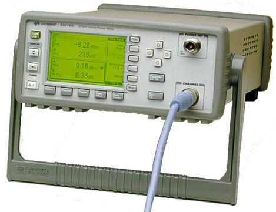  
EPM 系列功率计

# 4. 术语表

# 符号和缩写

B 噪声带宽  
BER 误码率  
|bs| 2 发生器传输给非反射负载  
C/N 载噪比  
DBS 卫星直播  
DSB 双边带  
DUT 待测件  
ENR dB 超噪比  
F 噪声因数  
F1 第一级噪声因数  
FM 频率调制  
Fmin 最小噪声因数  
Fsy 系统噪声因数  
1/f 闪烁噪声  
Gp 功率增益  
Gas 相关增益  
$\mathsf { G } _ { \mathsf { a } }$ 可用增益  
$\mathsf { G } _ { \mathrm { i } }$ 插入增益  
$\mathsf { G } _ { \mathrm { t } }$ 换能器增益  
G/T 增益温度比  
IEEE 电气和电子工程师协会  
IF 中频  
IRE 无线电工程师协会  
K 开尔文（温度单位）  
k 玻尔兹曼常数  
LNA 低噪声放大器  
LSB 下边带  
M 噪声测量  
$\mathsf { M } _ { \mathsf { u } }$ 失配不确定度  
Na 加性噪声  
NF 噪声系数  
Nof f $\mathsf { \Pi } = \mathsf { N } _ { \tau }$ （见“Y 因子”）  
Non $\mathbf { \tau } = \Nu _ { 2 }$ （见“Y 因子”）  
$\mathsf { N } _ { \uparrow }$ $\mathsf { N } _ { \mathsf { o u t } }$ for T（c 见“Y 因子”）  
$\mathsf { N } _ { 2 }$ $\mathsf { N } _ { \mathsf { o u t } }$ for $\top _ { \mathfrak { n } }$ （见“Y 因子”）  
$\mathsf { N } _ { \mathrm { i } }$ 输入噪声功率  
$\mathsf { N } _ { \mathrm { o } }$ 输出噪声功率  
RF 射频  
RMS 均方根  
$\mathsf { R } _ { \mathfrak { n } }$ 等效噪声电阻  
$\boldsymbol { \Gamma } _ { \mathfrak { n } }$ 归一化等效噪声电阻  
RSS 平方和开根号  
S/N 信噪比  
SSB 单边带  
$| \mathsf { S } _ { 2 1 } | ^ { 2 }$ 正向传输系数  
$\mathrm { S _ { j } }$ 输入信号功率  
So 输出信号功率  
Ta 噪声温度  
Tc 冷温（见 T）有效输入噪声温度  
$\top _ { \mathfrak { h } }$ 热温（见 $\tau _ { \mathfrak { h } } )$ ）有效噪声温度关机温度（见 $\mathsf { T } _ { \mathsf { o f f } } )$ ）  
T 开机温度（见 $\top _ { \mathsf { o n } }$ ）  
onTo 工作噪声温度  
T0 标准噪声温度 (290 K)  
Ts 等效源噪声温度  
USB 上边带  
Γopt 最佳源反射系数  
Γ 源反射系数  
ΓL 负载反射系数

# 术语表

相关增益 (G )。源反射系数为 Fmin 对应的最佳反射系数$( \Gamma _ { \mathrm { o p t } } )$ 时器件的可用增益。

可用增益 $( \mathsf { G } _ { \mathsf { a } } ) _ { \circ }$ 。[2、35、40] 在特定频率下，网络输出的可用功率 $\left( \mathsf { P } _ { \mathsf { a } \mathsf { o } } \right)$ 与  
源可用功率 $\big ( \mathsf { P } _ { \mathsf { a s } } \big )$ 之比。

$$
\mathsf { G } _ { \mathtt { a } } = \frac { \mathsf { P } _ { \mathtt { a } \mathtt { 0 } } } { \mathsf { P } _ { \mathtt { a } \mathtt { s } } }
$$

对于输出为 $| \mathsf { b } _ { \mathsf { s } } | ^ { 2 }$ 、反射系数为 Γ 的源

$$
\begin{array} { r l } { { \mathsf P } _ { \mathsf { a s } } = } & { \frac { \left| \mathsf { b } _ { \mathsf { s } } \right| ^ { 2 } } { 1 - \left| \mathsf { I } _ { \mathsf { s } } \right| ^ { 2 } } } \\ { { \mathsf { P } } _ { \mathsf { a 0 } } = } & { \frac { \left| \mathsf { b } _ { \mathsf { s } } \right| ^ { 2 } \left| \mathsf { S } _ { 2 1 } \right| ^ { 2 } \left( 1 - \left| \mathsf { T } _ { 2 } \right| ^ { 2 } \right) } { \left| \left( 1 - \mathsf { I } _ { \mathsf { s } } \mathsf { S } _ { 1 1 } \right) \left( 1 - \mathsf { T } _ { 2 } { } ^ { * } \mathsf { S } _ { 2 2 } \right) - \mathsf { I } _ { \mathsf { s } } \mathsf { I } _ { 2 } { } ^ { * } \mathsf { S } _ { 1 2 } \mathsf { S } _ { 2 1 } \right| ^ { 2 } } } \end{array}
$$

其中

$$
\mathrm { T } _ { 2 } { = } \mathrm { S } _ { 2 2 } + \ : \frac { \mathrm { S } _ { 1 2 } \mathrm { S } _ { 2 1 } \mathrm { r } _ { \mathrm { s } } } { 1 - \mathrm { S } _ { 1 1 } \mathrm { r } _ { \mathrm { s } } }
$$

可用输出功率的另一个表达式是

$$
\mathsf { P } _ { \mathsf { a } \mathsf { o } } = \mathsf { \frac { { | \mathsf { b } _ { \mathsf { s } } | } ^ { 2 } { | \mathsf { S } _ { 2 1 } | } ^ { 2 } } { | \uparrow - \mathsf { \Gamma } _ { \mathsf { s } } \mathsf { S } _ { 1 1 } | } }
$$

这样可以推导出 $\mathsf { G } _ { \mathsf { a } }$ 的两个表达式

$$
G _ { \mathrm { a } } = | \mathrm { S } _ { 2 1 } | ^ { 2 } \frac { ( 1 - \vert \Gamma _ { \mathrm { s } } \vert ^ { 2 } ) ( 1 - \vert \Gamma _ { 2 } \vert ^ { 2 } ) } { | ( 1 - \Gamma _ { \mathrm { s } } \mathrm { S } _ { 1 1 } ) ( 1 - \Gamma _ { 2 } { } ^ { \ast } \mathrm { S } _ { 2 2 } ) - \Gamma _ { \mathrm { s } } \Gamma _ { 2 } { } ^ { \ast } \mathrm { S } _ { 1 2 } \mathrm { S } _ { 2 1 } | ^ { 2 } }
$$

$$
\mathsf { G } _ { \mathrm { a } } = { | \mathsf { S } _ { 2 1 } | } ^ { 2 } \ \frac { 1 - { | \mathsf { r } _ { \mathrm { s } } | } ^ { 2 } } { | 1 - \mathsf { r } _ { \mathrm { s } } \mathsf { S } _ { 1 1 } | ^ { 2 } \left( 1 - { | \mathsf { r } _ { 2 } | } ^ { 2 } \right) }
$$

注： $\mathsf { G } _ { \mathrm { a } }$ 与网络参数和源反射系数 Γ 有关。 $\mathsf { G } _ { \mathrm { a } }$ 与负载反射系数 $\Gamma _ { \lfloor }$ 无关。 $\mathsf { G } _ { \mathrm { a } }$ 通常以 dB 表示

$$
G _ { a } ( d \mathsf { B } ) = 1 0 \mathsf { l o g } \frac { \mathsf { P } _ { a 0 } } { \mathsf { P } _ { a s } }
$$

带宽 (B)。见噪声带宽。

玻尔兹曼常数 (k)。 $1 . 3 8 \times 1 0 ^ { - 2 3 }$ 焦耳/开尔文。

级联效应。[8] 级联多个网络时，每个网络的噪声特性（F、T 和$\mathsf { G } _ { \mathsf { a ^ { \prime } } }$ ）与整个网络或组合网络的噪声特性的关系。

如果 $\mathsf { F } _ { \uparrow } \setminus$ 、F ……F（数值比，非 dB）是单个的噪声系数， $\mathsf { G } _ { \mathsf { a } 1 }$ $\mathsf { G } _ { \mathsf { a } _ { 2 } \cdots } \mathsf { G } _ { \mathsf { a n } }$ （数值比）就是单个的可用增益，组合噪声系数为

$$
\mathsf { F } = \mathsf { F } _ { 1 } + \frac { \mathsf { F } _ { 2 } - 1 } { \mathsf { G } _ { a 1 } } + \frac { \mathsf { F } _ { 3 } - 1 } { \mathsf { G } _ { a 1 } \mathsf { G } _ { a 2 } } + \cdots + \frac { \mathsf { F } _ { n } - 1 } { \mathsf { G } _ { a 1 } \mathsf { G } _ { a 2 } \ldots \mathsf { G } _ { a \left( n - 1 \right) } }
$$

组合可用增益为

$$
\mathsf { G } _ { \mathtt { a } } = \mathsf { G } _ { \mathtt { a } 1 } \mathsf { G } _ { \mathtt { a } 2 } \cdots \mathsf { G } _ { \mathtt { a } \mathtt { n } }
$$

就单个有效输入噪声温度 ${ \sf T } _ { \sf e 1 } .$ 、 $\boldsymbol { \mathsf { T } } _ { \mathsf { e } 2 } . . . . . \boldsymbol { \mathsf { T } } _ { \mathsf { e } \mathsf { n } }$ 而言，总有效输入噪声温度为

$$
\mathsf { T } _ { \mathtt { e } } = \mathsf { T } _ { \mathtt { e } 1 } + \frac { \mathsf { T } _ { \mathtt { e } 2 } } { \mathsf { G } _ { \mathtt { a } 1 } } + \frac { \mathsf { T } _ { \mathtt { e } 2 } } { \mathsf { G } _ { \mathtt { a } 1 } \mathsf { G } _ { \mathtt { a } 2 } } + \cdots + \mathrm { ~ \frac { \mathsf { T } _ { \mathtt { e } n } } { \mathsf { G } _ { \mathtt { a } 1 } \mathsf { G } _ { \mathtt { a } 2 } \dots \mathsf { G } _ { \mathtt { a } ( \Pi - 1 ) } } ~ }
$$

注：上述 Fi、Tei 和 Gai 指的是对应前一级输出阻抗的源阻抗值。

二极管噪声源。[11、12、13、15、20、21] 一种噪声源，主要依靠反向偏置进入雪崩区域的固态二极管中产生的噪声。如果器件的匹配良好，其过量噪声比通常为 15 dB 左右 $( \mathsf { T } _ { \mathsf { n e } } = 1 0 0 0 0 \mathsf { K } )$ 。如果牺牲阻抗匹配和平坦的频率响应，就可以获得较高的过量噪声比。

双边带 (DSB)。见“单边带 (SSB)”。

有效输入噪声温度 $( \mathsf { T } _ { \mathsf { e } } )$ 。[17] 如果连接了无噪声的DUT 等效物，在将实际 DUT 连接到无噪声输入端口阻抗时，分配给 DUT 输入端口处阻抗的噪声温度会产生与实际 DUT相同的输出功率。相同的温度同时适用于影响输出频率的全部频率。如果有多个输入端口，每个端口都有指定的阻抗，则相同的温度同时适用于全部端口。为了定义 T ，除输出外的所有其他端口均应视为输入端口。对于具有单个输入和输出频率的双端口传感器，T 与噪声系数 F的关系如下：

有效噪声温度 $( \overline { { \mathsf { I } } } _ { \mathsf { n e } } ) _ { \circ }$ 。[1] （这是噪声源等单端口器件的特性。）将噪声源连接非反射、非发射负载时，使噪声源输出端口产生功率的温度。噪声温度 $( \top _ { \mathsf { a } } )$ 和有效噪声温度 $( \mathsf { T } _ { \mathsf { n e } } )$ 之间的关系为

$$
{ \sf T } _ { \mathrm { n e } } = { \sf T } _ { \mathrm { a } } ( 1 - { \sf I } { \sf I } ^ { 2 } )
$$

其中 Γ 是噪声源的反射系数。新生功率的比例系数为 kB，因此

$$
T _ { n \mathrm { e } } = \frac { P _ { \mathrm { e } } } { ( \mathrm { k B ) } }
$$

其中，P 为新生功率， $\mathsf { k }$ 为玻尔兹曼常数，B 为功率测量的带宽。  
假设测量带宽上的功率谱密度保持恒定。

等效噪声电阻（ $( \mathfrak { r } _ { \mathfrak { n } }$ 或 $\mathsf { R } _ { \mathsf { n } ^ { \prime } }$ ）。见“噪声系数圈”。

过量噪声比 (ENR)。[1] 根据冷、热噪声温度（ $\tau _ { \mathfrak { h } }$ 和 T ）使用下式计算得出的噪声发生器特性

$$
E N R _ { \mathrm { d B } } = 1 0 \ \mathrm { l o g } \ \frac { \mathsf T _ { \mathrm { h } } - \mathsf T _ { \mathrm { c } } } { \mathsf T _ { 0 } }
$$

其中， ${ \sf T } _ { 0 }$ 为 $2 9 0 \mathsf { K }$ 的标准温度。噪声温度 $\top _ { \mathfrak { h } }$ 和 T 应为“有效”噪声温度。（见“有效噪声温度”）[25]。二极管噪声源的 ENR 校准假设 ${ \sf T } _ { \mathrm { c } } { = } { \sf T } _ { 0 } { \circ }$ 。

我们不妨看几个 ENR 与 ${ \sf T } _ { \sf h }$ 之间关系的例子。0 dB 的 ENR 对应$T _ { \mathfrak { h } } = 5 8 0 ~ \mathsf { K } _ { \mathfrak { c } }$ 。

${ 1 0 0 ^ { \circ } C }$ (373 K) 的 $\top _ { \mathfrak { h } }$ 对应 –5.43 dB 的 ENR。290 K 的 $\top _ { \mathfrak { h } }$ 对应 –∞dB 的 ENR。

$$
\mathsf { T } _ { \mathrm { e } } = 2 9 0 ( \mathsf { F } { - } 1 )
$$

闪烁噪声和 1/f 噪声。[33、39] 功率谱密度与频率成反比的噪声。  
在音频或 GASFET 低于 ${ 1 0 0 } \mathrm { M H z }$ 时尤为重要。

正向传输系数 $( \mathsf { S } _ { 2 1 } ) ^ { 2 }$ 。网络端接无反射负载并且被无反射发生器激励时，网络输出端在特定频率下所传送的功率与网络输入端所接收的功率之比。

该参数的大小通常以dB 为单位。

$$
| \mathsf { S } _ { 2 1 } | ^ { 2 } ( \mathsf { d B } ) = 1 0 \lfloor 0 \mathsf { g }  \mathsf { S } _ { 2 1 }  ^ { 2 }
$$

增益温度比 (G/T)。[32、41] 卫星或射电天文接收机系统（含天线）的品质因数，用于描述整个系统的运行状态。分子是天线增益，分母是接收机的工作噪声温度。该比值通常以 dB 表示，如 10log(G/T)。我们通常会将天线输入为热天体噪声源时的接收机响应与输入为空间背景辐射 (3K) 时的响应做比较，以此测量 G/T。

气体放电噪声源。[25、26] 取决于电离惰性气体温度的噪声源。这种类型的噪声源通常需要数千伏电压才能开始放电，但维持放电只需大约 100 V 电压。高导通电压的元器件有时会通过输出馈电，从而损坏某些脆弱的小型低噪声固态器件。在大多数应用中，气体放电噪声源已被雪崩二极管噪声源取代。气体放电管仍用于毫米波长。氩气管的超噪比 (ENR) 约为 15.5 dB (10000K)。

高斯噪声。[6] 概率分布或概率密度函数为高斯分布的噪声，即具有标准形式

$$
{ \sf p } ( { \sf x } ) = \frac { 1 - \frac { x ^ { 2 } } { 2 \sigma ^ { 2 } } } { \sigma \sqrt { 2 \pi } } { \sf e } ^ { { \frac { x ^ { 2 } } { 2 \sigma ^ { 2 } } } }
$$

其中， $\sigma$ 为标准差。根据概率论的中心极限定理，本质上稳定或静止的噪声是由大量小事件聚集在一起造成，其往往呈高斯分布。热噪声和散粒噪声就呈高斯分布。

热/冷噪声源。在某种意义上，大多数噪声系数测量取决于在两个源温度（一热一冷）下进行的噪声功率测量。然而，“冷/热”这一表述通常指在液氮温度 (77 K) 甚至是液氦温度 (4 K) 下使用冷端进行测量，或者是在 $3 7 3 \ K \left( 1 0 0 ^ { \circ } \mathrm { C } \right)$ 下使用热端进行测量。这种终端有时被用作主要标准，用于高精度的校准实验室测量。

插入增益 (Gi)。将 DUT 插入发生器和负载之间测得的增益。该比率的分子是插入 DUT 时传递给负载的功率 $\mathrm { ( P _ { d } ) }$ 。分母或参考功率(P ) 是直接连接到源时传递给负载的功率。分母的测量可称为校准步骤。

$$
\mathsf { G } _ { \mathrm { i } } = \frac { \mathsf { P } _ { \mathrm { d } } } { \mathsf { P } _ { \mathrm { r } } }
$$

源和负载直接连接时的负载功率为

$$
\mathsf { P } _ { \mathsf { r } } = \mathsf { I b } _ { \mathsf { r } } | ^ { 2 } \frac { 1 - \mathsf { I } \bar { \Gamma _ { \uparrow } } | ^ { 2 } } { \mathsf { I } \bar { \mathsf { 1 } } - \mathsf { \Gamma } \bar { \Gamma _ { \uparrow } } \bar { \Gamma _ { \mathrm { s } } } | ^ { 2 } }
$$

其中下标 $r$ 表示确立参考功率时（即校准步骤期间）的源特性。插入 DUT 时的负载功率为

$$
\mathsf { P } _ { \mathrm { d } } = { | \mathsf { b } _ { \mathrm { d } } | } ^ { 2 } { | \mathsf { S } _ { 2 1 } | } ^ { 2 } \ \frac { 1 - | \mathsf { r } _ { 1 } | ^ { 2 } } { | ( 1 - \Gamma _ { \mathrm { s d } } \mathsf { S } _ { 1 1 } ) ( 1 - \Gamma _ { 1 } \mathsf { S } _ { 2 2 } ) - \Gamma _ { 1 } \mathsf { S } _ { 1 2 } \mathsf { S } _ { 2 1 } | ^ { 2 } }
$$

或

$$
\mathsf { P } _ { \mathrm { d } } = \vert \mathsf { b } _ { \mathrm { d } } \vert ^ { 2 } \vert \mathsf { S } _ { 2 1 } \vert ^ { 2 } \frac { 1 - \vert \mathsf { r } _ { 1 } \vert ^ { 2 } } { \vert \boldsymbol { \uparrow } - \Gamma _ { \mathrm { s d } } \mathsf { S } _ { 1 1 } \vert ^ { 2 } \vert \boldsymbol { \uparrow } \boldsymbol { \uparrow } - \Gamma _ { 1 } \Gamma _ { 2 } \vert ^ { 2 } }
$$

$$
\mathsf T _ { 2 } = \mathsf S _ { 2 2 } + \mathrm { \Delta } \frac { \mathsf S _ { 1 2 } \mathsf S _ { 2 1 } \mathsf T _ { s d } } { 1 - \mathsf T _ { s d } \mathsf S _ { 1 1 } }
$$

在公式（3、4 和 5）中，下标 $d$ 表示插入 DUT 时的源特性。S 参数指的是 DUT。校准期间和插入 DUT 时的源特性有时会不同。假设 DUT 是具有波导输入和 ${ 7 0 } ~ \mathsf { M H z }$ 中频输出的微波接收机。在校准步骤期间，源具有 $7 0 ~ \mathsf { M H z }$ 的同轴输出，但插入 DUT 时，源具有微波频率的波导输出。使用上述公式计算的插入增益为

$$
\mathsf { G } _ { \mathrm { i } } = \bigl | \mathsf { S } _ { 2 1 } \bigr | ^ { 2 } \frac { | \mathsf { b } _ { \mathrm { d } } | ^ { 2 } } { \vert \mathsf { b } _ { \mathrm { r } } \vert ^ { 2 } } \frac { \vert \mathsf { 1 } - \Gamma _ { 1 } \Gamma _ { \mathrm { s r } } \vert ^ { 2 } } { \vert ( 1 - \Gamma _ { \mathrm { s d } } \mathsf { S } _ { 1 1 } ) ( 1 - \Gamma _ { 1 } \mathsf { S } _ { 2 2 } ) - \Gamma _ { 1 } \Gamma _ { \mathrm { s d } } \mathsf { S } _ { 1 2 } \mathsf { S } _ { 2 1 } \vert ^ { 2 } }
$$

或

$$
G _ { \mathrm { i } } = { \lvert \mathrm { S } _ { 2 1 } \rvert } ^ { 2 } \frac { { \lvert \mathrm { b } _ { \mathrm { d } } \rvert } ^ { 2 } } { { \lvert \mathrm { b } _ { \mathrm { r } } \rvert } ^ { 2 } } \frac { { \lvert \mathrm { 1 } - \Gamma _ { \mathrm { 1 } } \Gamma _ { \mathrm { s r } } \rvert } ^ { 2 } } { { \lvert \mathrm { 1 } - \Gamma _ { \mathrm { s d } } \mathrm { S } _ { 1 1 } \rvert } ^ { 2 } { \lvert \mathrm { 1 } - \Gamma _ { \mathrm { 1 } } \Gamma _ { 2 } \rvert } ^ { 2 } }
$$

如果校准步骤期间和插入 DUT 时使用了频率相同的源，则 $| { \mathsf { b } } _ { \mathrm { d } } | ^ { 2 } =$ $| \mathsf { b } _ { \mathsf { r } } | ^ { 2 }$ 且 $\mathsf { G } _ { \mathsf { s r } } \mathsf { = G } _ { \mathsf { s d } }$ 。测量放大器时通常就是这种情况。

仪器不确定度。电子仪器电路中的误码造成的不确定度。就噪声系数分析仪/表而言，这包括由检波器、模数转换器、数学舍入效应、混频器非线性、饱和效应和测量过程中的增益不稳定性引起的误码。这种不确定度通常被误认为是总体测量精度，因为在技术指标中很容易找到它。然而，在现代技术中，不确定度很少是因它而起。

约翰逊噪声。[19] 同“热噪声”。

最小噪声系数 (Fmin)。参见“噪声系数圈”。

失配不确定度 (Mu)。失配不确定度  
由一个器件（源）与其后面的器件（负载）之间的反射引起。如果使用了无反射负载，再反射会导致源发射的功率（入射至负载）发生变化。

入射至负载的功率（包括再反射效应）可以用下式表示

$$
\mathsf { P } _ { \mathrm { i } } = \frac { \left| \mathsf { b } _ { \mathrm { s } } \right| ^ { 2 } } { \left| \mathsf { 1 } - \mathsf { r } _ { \mathrm { s } } \mathsf { r } _ { \mathrm { i } } \right| ^ { 2 } }
$$

其中 $| \boldsymbol { \mathrm { b } } _ { \mathrm { s } } | ^ { 2 }$ 是源传递给非反射负载的功率，Γ 是源反射系数，Γ 是负载反射系数。如果要在已知 $| \mathsf { b } _ { \mathsf { s } } | ^ { 2 }$ 的情况下对入射功率进行准确评估，或者是反过来，那么我们需要知道 Γ 和 $\Gamma _ { \lfloor }$ 的相位和幅值，这可能需要通过矢量网络分析仪来测量。

如果不知道反射系数的相位，我们可以根据 Γ 和 Γ 的幅值（如 $\mathsf { P } _ { \mathrm { s } }$ 和 P）来计算 $\lvert 1 - \Gamma _ { \mathrm { s } } \Gamma _ { \lfloor } \rvert ^ { 2 }$ 的极值。我们可以通过列线图找到$| 1 - \Gamma _ { \mathrm { { s } } } \Gamma _ { \mathrm { { l } } } | ^ { 2 }$ 的极值，单位：dB（图 4-l）。

$$
\mathsf { M } _ { \mathsf { u } } = 2 0 \mathsf { l o g } \left( \mathsf { 1 } \pm \mathsf { P } _ { \mathsf { s } } \mathsf { P } _ { \mathsf { s } } \right)
$$

失配对噪声系数测量的影响极其复杂，分析难度很大。以一个阻抗不是 $5 0 \Omega$ 的噪声源为例。

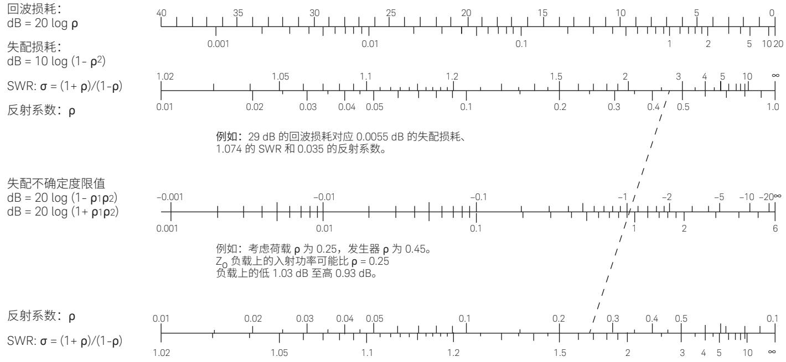  
图 4-1. 这个列线图给出了只有反射系数幅值已知时再反射的极端影响。列线图的失配不确定度限值适用于输入端包含隔离器的器件的噪声系数测量精度。

源参与了其自身产生的噪声的再反射，但它也会反射源自 DUT 并从 DUT 输入端涌现的噪声（DUT 添加的噪声最终是源阻抗的函数）。源阻抗发生改变也会导致 DUT 的可用增益改变（请记住，可用增益也是源阻抗的函数）。由于冷热状态下的源阻抗会发生变化，因此情况可能会更加复杂。[23] 建立一个用于评估失配影响的简单法则的尝试有很多，但都没有完全成功。Strid [36] 分析了一个非常重要的案例，得出了一个特别简单的结果。Strid 认为，输入端包含隔离器的 DUT 具有足够的隔离效果，可以防止后续器件与噪声源相互影响。最终结果中包含隔离器输入产生的噪声影响以及隔离器与噪声源之间的再反射。该结果中，噪声系数的误差为

（其中 $\mathsf { F } _ { \mathrm { a c t } }$ 为无反射噪声源的噪声系数）

$$
\begin{array} { r } { \Delta { \sf F } ( { \sf d } { \sf B } ) = { \sf F } _ { \sf \mathrm { a c t } } ( | 0 { \sf g } ) - { \sf F } _ { \sf \mathrm { i n d } } ( { \sf d } { \sf B } ) } \\ { = 1 0 \log \ \frac { 1 } { | 1 - { \sf S } _ { 1 1 } { \sf r } _ { \mathrm { s h } } | ^ { 2 } } } \end{array}
$$

$\mathsf { F } _ { \mathrm { i n d } }$ 为测得的噪声系数， $\mathsf { S } _ { 1 1 }$ 为进入 DUT（如进入隔离器输入端）的反射系数， $\mathsf { G } _ { \mathsf { s h } }$ 为热温或开启条件下噪声源的反射系数。Strid还假设隔离器和 $\mathsf { T } _ { \mathsf { c o l d } }$ 均为 290 K。请注意，该结果与 DUT 的噪声系数、Y 因子和 $\mathsf { T } _ { \mathsf { c o l d } }$ 的噪声源反射系数无关。

在表征测量系统的噪声贡献时，以及在增益测量期间的 DUT 输出端，也可能产生失配不确定度。我们可以通过评测可用增益与插入增益之间的差异来计算增益测量失配效应。

失配不确定度通常是噪声系数测量中最关键的不确定度。校正通常需要完整地表征噪声（见“噪声系数圈”）并测量反射系数的相位和振幅。

$\mathsf { N } _ { \uparrow }$ 见“Y 因子”。  
$\mathsf { N } _ { 2 }$ 见“Y 因子”。  
$\mathsf { N } _ { \mathsf { o f f } }$ 同 N1。见“Y 因子”。  
$\mathsf { N } _ { \mathsf { o n } }$ 同 N2。见“Y 因子”。

加性噪声 $( \mathsf { N } _ { \mathsf { a } } )$ 。来自被测网络内部信号源的输出噪声功率分量。这一输出噪声分量通常与放大网络输入源产生的噪声所得到的分量区别开来。加性噪声有时指输入端口，输出端添加的噪声功率要除以 G。

噪声带宽 (B)。[18、26] 与拟采用的实际系统传递相同数量噪声功率的等效矩形通带。通带的高度是某一参考频率下的传感器功率增益。我们通常选择频段中心频率或最大增益的频率作为参考频率。等效（矩形）增益频率曲线下方的面积等于实际增益频率曲线下方的面积。在下式中

$$
\mathsf { B } = \int _ { 0 } ^ { \infty } \frac { \mathsf { G } ( \mathsf { f } ) \mathrm { d } \mathsf { f } } { \mathsf { G } _ { 0 } }
$$

$\mathsf { G } _ { \circ }$ 为参考频率下的增益。在多级系统中，噪声带宽接近等于 3dB 带宽。

噪声系数和噪声因数（NF 和 F）。[7] 在指定的输入频率下，噪声因数是 (1) 与 (2) 之比，其中 (1) 是输入端接的噪声温度在全部频率下均为标准值 (290 K) 时输出端口上可用的相应输出频率下的总噪声功率/赫兹；(2) 是因输入端接产生的那部分输出功率。

我们通常认为输出噪声功率具有两个分量：器件添加的噪声 $( \Nu _ { \mathrm { \overline { { a } } } } )$ 和放大的输入噪声，例如，由 DUT 放大的输入端接的输出功率$( \mathsf { k } \mathsf { T } _ { 0 } \mathsf { B } \mathsf { G } )$ 。然后，我们可以得出噪声系数公式

注：用噪声系数表征系统只有在

$$
\mathsf { F } = \begin{array} { c } { \frac { \mathsf { N } _ { \mathrm { a } } + \mathsf { k } \mathsf { T } _ { \mathrm { 0 } } \mathsf { B } \mathsf { G } } { \mathsf { k } \mathsf { T } _ { \mathrm { 0 } } \mathsf { B } \mathsf { G } } } \end{array}
$$

指定了输入短接的阻抗（或其等效值）时才有意义。

噪声系数和噪声因数有时通过下式区分 [31]噪声系数 $=$ 10 log (噪声因数)

因此，噪声系数以 dB 为单位，噪声因数则是数字比率。在其他场合，这两个词可以互换。但是，这两个词不得混淆，因为取 10log (NF) 时，我们总是会使用 dB 这个符号。没有 dB 符号则表示数字比率。

噪声系数圈。[9、18] 它指的是绘制在网络所见的源阻抗、导纳或反射系数复平面上时，网络恒定噪声系数的等高线。表达网络的噪声因数与源反射系数 (Γ) 之间关系的通用公式是

$$
\mathsf { F } = \mathsf { F } _ { \mathsf { m i n } } + \mathrm { ~ \frac { 4 \mathsf { R } _ { \mathsf { n } } } { \mathsf { Z } _ { \mathsf { o } } } ~ } \cdot \mathrm { ~ \frac { \mathsf { \Pi } \bigl | \bar { \Gamma } _ { \mathrm { { o p t } } } - \bar { \Gamma } _ { \mathrm { { s } } } \bigr | ^ { 2 } } { \bigl | \bar { \mathsf { l } } + \bar { \Gamma } _ { \mathrm { { o p t } } } \bigr | ^ { 2 } \mathsf { S } \bigl ( \bar { \mathsf { l } } - \bigl | \bar { \Gamma } _ { \mathrm { { s } } } \bigr | ^ { 2 } \bigr ) } ~ }
$$

其中， $\Gamma _ { \mathrm { o p t } }$ 为得到最小网络噪声系数的源反射系数， $\digamma _ { \mathrm { m i n } }$ 为最小噪声系数， $\dot { Z } _ { \scriptscriptstyle 0 }$ 为定义 $\Gamma _ { \mathrm { s } }$ 的参考阻抗（通常为 $5 0 \Omega$ ）， $\mathsf { R } _ { \mathsf { n } }$ 为等效噪声电阻。 $\mathsf { R } _ { \mathsf { n } } / \mathsf { Z } _ { \mathsf { o } }$ 有时会作为一个参数 $( \mathfrak { r } _ { \mathfrak { n } } )$ 给出，称为归一化等效噪声电阻。常数 F 的轨迹被作为 $\Gamma _ { \mathrm { s } }$ 的函数绘制，在复平面上形成圈。具有可用增益圈的噪声系数圈非常有助于电路设计人员深入了解如何优化整个网络，从而获得低噪声系数和平坦的增益。

噪声测量 $( \mathsf { M } )$ 。[14] 包含网络噪声系数和增益的质量因数，如下所示

$$
\begin{array} { l l } { { \sf M } = } & { { \displaystyle \frac { ( { \sf F } - 1 ) } { \mathit { \Omega } _ { 1 } - { \displaystyle \frac { 1 } { { \sf G } } } } } } \end{array}
$$

如果要级联具有不同噪声系数和增益的两个放大器，应当在输入端使用具有最低M的放大器，从而尽量降低总噪声系数。与噪声系数和可用功率增益一样，网络的噪声测量通常会随源阻抗而变化 [9]。为了决定首先放置哪个放大器，源阻抗必须使每个放大器的 F 和 G 与级联顺序无关。

噪声测量也用于表示相同网络无限级联的总噪声系数。总噪声系数为

$$
F _ { \mathrm { t o t } } = F + \frac { F - 1 } { G _ { a } } + \frac { F - 1 } { G _ { a } ^ { 2 } } + \frac { F - 1 } { G _ { a } ^ { 3 } } + \cdots
$$

噪声温度 $( \mathsf { T } _ { \mathsf { a } } )$ 。[1] 使源产生可用功率谱密度的温度。当发生器和负载的相应反射系数为复共轭时，可以得到该结果。它与可用功率 $( \mathsf { P } _ { \mathsf { a } } )$ 的关系为

$$
T _ { a } = \frac { P _ { a } } { k \mathrm { B } }
$$

其中，k 为玻尔兹曼常数，B 为功率测量的带宽。测量频段上的功率谱密度需保持恒定。另见“有效噪声温度 $( \top _ { \mathsf { n } \mathsf { e } } ) ^ { : }$ ”。

噪声温度可以等效定义 [26] 为无源源电阻的温度，该源电阻具有与实际源相同的可用噪声功率谱密度。

奈奎斯特定理。见“热噪声”。

工作噪声温度 (Top)。[7] 温度（单位：开尔文）可用下式计算：

$$
\mathsf { T } _ { \mathsf { o p } } = \frac { \mathsf { N } _ { \mathsf { o } } } { \mathsf { k G } _ { \mathsf { s } } }
$$

其中， $\mathsf { N } _ { \mathrm { o } }$ 是 DUT 在工作条件下以指定输出频率向输出电路输出的噪声功率/赫兹，k为波尔兹曼常数， $\mathsfit { G } _ { \mathrm { s } }$ 为信号的传感器功率增益。注：在具有单个输入和输出频率的双端口线性传感器中，T与输入端的噪声温度 $( T _ { \mathrm { e } } )$ 和有效输入噪声温度 (T ) 相关，其关系用下式表达：

$$
\boldsymbol { \mathsf { T } } _ { \mathsf { o p } } = \boldsymbol { \mathsf { T } } _ { \mathsf { a } } + \boldsymbol { \mathsf { T } } _ { \mathsf { a } }
$$

最佳反射系数（ $( \Gamma _ { \tt o p t } )$ ）。见“噪声系数圈”。

分配噪声。[26、39] 由于器件的各个电极或元器件之间存在随机分配的电流，因此会形成额外的噪声。

$$
F _ { _ { \mathrm { t o t } } } = 1 + { \frac { \mathsf { F } - 1 } { 1 - { \frac { 1 } { \mathsf { G } _ { \mathrm { a } } } } } }
$$

$$
\mathsf { F } _ { \mathrm { t o t } } = 1 \mathrm { ~ + ~ } \mathsf { M }
$$

公式 (2) 中的 $\mathsf { F } _ { \mathrm { t o t } }$ 有时被称为噪声测量，用以代替公式 (1) 中的M。我们应当注意使用的是哪个定义，因为它们相差 1。

功率增益 $( \mathsf { G p } )$ 。[2、35、40] 在特定频率下，网络向任意负载 (P ) 传输的功率与源向网络传输的功率 $( \mathsf { P } _ { \mathsf { s } } )$ 之比。

$$
G _ { _ { p } } = \ \frac { P _ { _ { 1 } } } { P _ { _ { s } } }
$$

提到噪声时，人们通常会使用功率增益和符号 G，但他们想表达的可能是可用功率增益 $( { \cal G } _ { a } )$ 、传感器功率增益 $( G _ { t } )$ 或插入功率增益 $( G )$ 。对于任意源和负载，网络的功率增益可通过下式得出

$$
G _ { _ { p } } = { | \mathsf S _ { 2 1 } | } ^ { 2 } \quad \frac { 1 - { | \mathsf I _ { | } | } ^ { 2 } } { | 1 - { | \mathsf I _ { | } | } ^ { 2 } ( 1 - { | \mathsf I _ { | } | } ^ { 2 } ) }
$$

其中

$$
{ \Gamma _ { \scriptscriptstyle 1 } = \mathrm { S } _ { \scriptscriptstyle 1 \uparrow } } ^ { 2 } + \mathrm { ~ { \cfrac { \mathrm { S } _ { \scriptscriptstyle 1 2 } \mathrm { S } _ { \scriptscriptstyle 2 \uparrow } \Gamma _ { \scriptscriptstyle 1 } } { \mathrm { 1 } - \Gamma _ { \scriptscriptstyle 1 } \mathrm { S } _ { \scriptscriptstyle 2 2 } } } ~ } 
$$

注 1： $\mathsf { G } _ { \mathsf { P } }$ 与负载反射系数和网络散射参数有关，但与源反射系数无关。

注 2： $\mathsf { G } _ { \mathsf { P } }$ 的表达式与 $\mathsf { G } _ { \mathsf { a } }$ 相同

（如果用 $\mathsf { G } _ { \mathsf { s } }$ 替代 $\mathsf { G } _ { \mathsf { I } }$ ，用 $\mathsf { S } _ { 2 2 }$ 替代 $\mathsf { S } _ { 1 1 }$ 的话)。

$\mathsf { G } _ { \mathsf { P } }$ 通常以 dB 表示

$$
G _ { _ { p } } ( d \mathsf { B } ) = 1 0 \mathsf { 1 0 9 } \ \frac { \mathsf { P } _ { _ { \mathsf { I } } } } { \mathsf { P } _ { _ { \mathsf { S } } } }
$$

RSS（平方和开根号）不确定度。

一种将已知限值的单个不确定度组合起来得出整体不确定度的方法。如果某个特定测量得出单个的不确定度 ±A、±B、 $\pm \complement$ 等，则RSS 不确定度为

$$
U _ { \mathrm { R S S } } = { ( \mathsf { A } ^ { 2 } + \mathsf { B } ^ { 2 } + \mathsf { C } ^ { 2 } + \ldots ) } ^ { 1 / 2 }
$$

RSS 不确定度基于这样一个事实，即大多数测量误差都是彼此无关的，尽管它们都是系统误差而非随机误差。正因为它们彼此无关，所以它们对于彼此具有随机性，会像随机变量一样组合在一起。

第二级效应。在DUT为第一级、测量设备为第二级的测量情况下的级联效应参考。测得的噪声系数是级联到测量设备的 DUT 的组合噪声系数。如果 F2只是测量系统的噪声因数，Fsys 是 DUT 和系统的组合噪声因数，那么 DUT 的噪声因数 (F1) 为

$$
\mathsf { F } _ { 1 } = \mathsf { F } _ { \mathrm { s y s } } - \mathrm { \small ~ \displaystyle \frac { \mathsf { F } _ { 2 } - 1 } { G } ~ }
$$

其中，G 是 DUT 的增益。

注：公式 (1) 中的 $\mathsf { F } _ { 2 }$ 是测量系统的噪声因数，该测量系统用于测量与 DUT 输出阻抗对应的源阻抗。

灵敏度。网络能够可靠检测到的最小信号。灵敏度指定了网络输入端最小信号的强度。根据该强度，输出信号功率为 M 乘以输出噪声功率，其中 $\mathsf { M }$ 的值必须指定。 $\mathsf { M } = \mathsf { \bar { T } }$ 比较常用。当源温度为290 K 时，灵敏度与噪声系数的关系为

（单位：dBm）

$$
\mathsf { S } _ { \mathrm { i } } = \mathsf { M k T } _ { 0 } \mathsf { B F }
$$

$$
S _ { \mathrm { i } } ( \mathrm { d } \mathsf { B } \mathsf { m } ) = - 1 7 4 \mathrm { d } \mathsf { B } \mathsf { m } + \mathsf { F } ( \mathrm { d } \mathsf { B } ) + 1 0 \mathsf { l } 0 \mathsf { g } \mathsf { B } + 1 0 \mathsf { l } 0 \mathsf { g } \mathsf { M }
$$

因此，在带宽已知的情况下，灵敏度与地面系统中的噪声系数有关。

散粒噪声。[6、39] 噪声是因电流的量子化和随机性质所致。电流不是连续的，而是量子化的，受到最小电荷单位（ $\mathrm { { ( e { = } 1 . 6 \times 1 0 ^ { - 1 9 } } }$ 库仑）的限制。电荷粒子也按照随机间隔流动。一个电荷单位到达边界的时间与上一个电荷单位的到达时间或下一个电荷单位的到达时间无关。当直流电流 Io 流动时，平均电流为 Io，但这并不能告诉我们电流的变化是多少，或者是电流的随机变化涉及哪些频率。对随机出现的粒子流进行统计分析可知，均方电流变化在频率上均匀分布，一直到载流子穿过器件的渡越时间的倒数为止。与热噪声一样，该噪声电流产生的噪声功率在负载电阻中产生的功率与带宽成正比。

$$
{ \ i } _ { \mathsf { n } } ^ { 2 } \left( \mathsf { f } \right) = 2 { \mathsf { e l } } _ { \mathsf { o } } \left[ { \mathsf { A } } ^ { 2 } / { \mathsf { H } } z \right]
$$

该公式适用于那些周期远小于载波在设备上传输时间的频率。流经负载电阻的噪声电流形成的功率变化被称为散粒噪声。

单边带 (SSB)。指仅使用转换为中频的两个主频段当中的一个。在噪声系数研究中，单边带源于通信系统中调制方案附带的含义，载波一侧的能量被抑制，从而更高效地利用无线电频谱。许多噪声系数测量是在包含下变频的系统中进行，下变频在 $\mathsf { f } _ { \mathsf { L O } }$ 频率使用混频器和本地振荡器生成中频 $\boldsymbol { \mathsf { f } } _ { _ { | \mathsf { F } } }$ 。具有带宽 B 的放大器通常会增加来自混频器的中频功率。在这些下变频系统中，有些只对以$\mathsf { f } _ { \mathsf { L O } } + \mathsf { f } _ { \mathsf { I F } }$ 为中心频率的带宽 B 上的信号做出响应。它们是在上边带(USB) 上进行的单边带测量。也有一些系统只对以 $\mathsf { f } _ { \mathsf { L } 0 } - \mathsf { f } _ { \mathsf { I } \mathsf { F } }$ 为中心频率的带宽 B 上的信号做出响应。它们是在下边带 (LSB) 上进行的单边带测量。其他系统则会对两个频段的信号都做出响应。这种测量称为双边带 (DSB) 测量。SSB 系统通常使用预选滤波或镜像抑制来消除不想要的边带。

如果将接收机或混频器的 DSB 噪声系数测量结果理解为单边带应用，则经常会出现混淆。造成混淆的原因是噪声系数的定义（见本术语表中“噪声系数”下的注释）指出，分子应当包括系统所有频率变换产生的噪声，包括镜像频率和其他杂散响应，但分母应当只包括系统的主要频率变换。就对上边带和下边带做出同等响应的系统而言，如果预期的频率转换只用于一个边带，定义中的分母噪声功率应当为测得的因输入噪声导致的总输出功率的一半（假设两个频段中的增益和带宽相同）。双边带噪声系数测量通常不做此区分。由于噪声源包含所有频率下的噪声，因此分子和分母包含所有频率变换。这样一来，如果被测网络的最终应用只在一个边带上有需要的信号，但却对两个边带的噪声都做出响应，那么 DSB 测量的分母太大，测得的噪声系数太小，通常得到大约为 2 的系数 (3dB)。

有时我们需要两个边带的信息并对其加以处理。测得的 DSB 噪声系数很合适，无需进行校正。在很多这样的应用中，被测量的信号是辐射信号，因此接收机被称为辐射计。射电天文学就使用辐射计。

用对两个边带都做出响应的测量系统来测量放大器的噪声系数不应包含 3 dB 校正系数。在这种情况下，噪声系数测量系统作为辐射计运行，因为它使用了两个边带上的信息。

(T0)[7] 290 K

Tc Tcold $\mathsf { T } _ { \mathsf { h } }$ Thot Toff Tcold Ton Thot [192630]

$$
\overline { { { \mathsf { e } } _ { \mathsf { n } } } } ^ { 2 } = 4 \mathsf { k } \mathsf { T } \int _ { \mathsf { f } _ { 1 } } ^ { \mathsf { f } _ { 2 } } \mathsf { R } ( \mathsf { f } ) \mathsf { p } ( \mathsf { f } ) \mathrm { d } \mathsf { f }
$$

$$
{ \sf p } ( { \sf f } ) = \mathrm { ~ \small ~ \displaystyle \frac { h f } { k T } ~ } _ { ( \mathrm { e } ^ { \mathrm { \small ~ \left. ~ k T ~ \right)} } - 1  ^ { - 1 } }
$$

≈ 1

$$
\textsf { k } 1 . 3 8 \times 1 0 ^ { - 2 3 } / \mathsf { T } \textsf { R } \Omega \mathsf { f } \mathsf { H } z \mathsf { f } _ { 1 } \textsf { f } _ { 2 } \mathsf { h } 6 . 6 2 \times 1 0 ^ { - 3 4 }
$$

对于 100 GHz 以下频率和

$\top = 2 9 0 \mathsf { K } . \mathsf { \Omega } \mathsf { l } \mathsf { \Omega } \mathrm { > p \Omega } ( \mathsf { f } ) \mathsf { \Omega } \mathrm { > 0 . 9 9 2 }$ 的情况， $\mathsf { p } ( \mathsf { f } ) = \mathsf { \widetilde { l } }$ ，公式 (l) 变为

$$
\begin{array} { c } { { \overline { { { \bf e } _ { \mathrm { n } } ^ { 2 } } } = 4 \mathrm { ~ k } \mathsf { T } \mathsf { R } ( \mathsf { f } _ { 2 } - \mathsf { f } _ { 1 } ) } } \\ { { { } } } \\ { { = 4 \mathrm { ~ k } \mathsf { T } \mathsf { R } \mathsf { B } } } \end{array}
$$

可用功率（即在绝对零度下传递给复共轭负载的功率）为

$$
\mathsf { P } _ { \mathrm { a } } = \overline { { \frac { \mathsf { e } _ { \mathsf { n } } ^ { \ 2 } } { 4 \mathsf { R } } } }
$$

kTB 的单位通常为焦耳/秒，与瓦特相同。

可用功率谱密度为 kT 瓦特/赫兹。尽管这一发展看起来让公式 (3)比 (4) 更为基础，Nyquist [30] 还是先得出了功率谱密度的值（公式(4)），然后计算出了所涉及的电压和电流（公式 (2)）。电压发生器的表达式为

$$
\mathsf { e } _ { \mathsf { n } } ^ { \mathrm { ~ 2 } } \mathrm { d } \mathsf { f } = 4 \mathsf { R } \mathsf { k } \mathsf { T } \mathrm { d } \mathsf { f }
$$

公式 (5) 通常被称为奈奎斯特定理。不要将其与奈奎斯特在其他领域的成果混淆，例如采样理论和稳定性标准。这些领域的其他一些关系也可称为奈奎斯特定理。当 T 等于

标准温度 $\mathsf { T } _ { 0 } \left( 2 9 0 \mathsf { K } \right)$ 时， $\mathsf { k T } _ { 0 } = 4 \times 1 0 ^ { - 2 1 } \mathrm { \ W } / \mathsf { H } z = - 1 7 4 \mathrm { \ d B m } / \mathsf { H } z \mathrm { o }$ 对 kTB 进行简单的检查可知，每个因素都有意义。玻尔兹曼常数$\mathsf { k }$ 给出了每个粒子的平均机械能，该能量可通过电气手段在不同温度下耦合输出。因此，玻尔兹曼常数是绝对温度和焦耳这两种能量表达式之间的转换常数。

可用功率直接取决于温度。以较高温度或较大振动形式存在的能量越多，每秒可以去除的能量就越多。

传感器功率增益 (Gt)。[2、35、40] 在特定频率下，网络向任意负载(P) 传输的功率与源向网络传输的可用功率 $( \mathsf { P } _ { \mathsf { a s } } )$ 之比。

$$
\mathsf { G } _ { \mathrm { t } } = \frac { \mathsf { P } _ { \mathrm { _ l } } } { \mathsf { P } _ { \mathrm { _ a s } } }
$$

对于强度为 $| \mathsf { b } _ { \mathsf { s } } | ^ { 2 }$ 、反射系数为 $\Gamma _ { \mathrm { s } }$ 的源，负载反射系数 $\mathsf { G } _ { \harpoonright }$ 。

$$
\mathsf { P } _ { \mathsf { a s } } = \mathrm { \small ~ \frac { ~ { | b _ { s } | } ^ { 2 } } { ~ 1 ~ { - } ~ { | \Gamma _ { s } | } ^ { 2 } ~ } }
$$

$$
P _ { \mathrm { \Lambda } } = \ \frac { | \mathsf { b } _ { \mathrm { s } } | ^ { 2 } | \mathsf { S } _ { 2 1 } | ^ { 2 } ( 1 - | \mathsf { \Gamma } _ { 1 } | ^ { 2 } ) } { | ( 1 - \Gamma _ { \mathrm { \Lambda } } \mathsf { S } _ { 1 1 } ) ( 1 - \Gamma _ { \mathrm { \Lambda } } \mathsf { S } _ { 2 2 } ) - \Gamma _ { 1 } \Gamma _ { \mathrm { \Lambda } } \mathsf { S } _ { 1 2 } \mathsf { S } _ { 2 1 } | ^ { 2 } }
$$

其中，S 参数指 DUT。 $\mathsf { P } _ { \mathcal { T } }$ 的等效表达式为

$$
{ \sf P } _ { \mathrm { \Lambda } } = \ \frac { \left| { \sf b } _ { \mathrm { s } } \right| ^ { 2 } \left| { \sf S } _ { 2 1 } \right| ^ { 2 } \left( 1 - \left| \Gamma _ { 1 } \right| ^ { 2 } \right) } { \left| \uparrow - \Gamma _ { \mathrm { s } } { \sf S } _ { 1 1 } \right| ^ { 2 } \left| \uparrow - \Gamma _ { 1 } \Gamma _ { 2 } \right| ^ { 2 } }
$$

其中

$$
\Gamma _ { _ 2 } = \mathrm { S } _ { _ { 2 2 } } + \ \frac { \mathrm { S } _ { _ { 1 2 } } \mathrm { S } _ { _ { 2 1 } } \Gamma _ { _ { \mathrm { s } } } } { 1 - \Gamma _ { _ { \mathrm { s } } } \mathrm { S } _ { _ { 1 1 } } }
$$

传感器增益则为

$$
G _ { \mathrm { t } } = { | \mathrm { S } _ { 2 1 } | } ^ { 2 } \frac { ( 1 - { | \Gamma _ { \mathrm { s } } | } ^ { 2 } ) ( 1 - { | \Gamma _ { 1 } | } ^ { 2 } ) } { | ( 1 - { \Gamma _ { \mathrm { s } } \mathrm { S } _ { 1 1 } } ) ( 1 - { \Gamma _ { 1 } \mathrm { S } _ { 2 2 } } ) - { \Gamma _ { 1 } \Gamma _ { \mathrm { s } } \mathrm { S } _ { 1 2 } \mathrm { S } _ { 2 1 } | } ^ { 2 } }
$$

$$
G _ { \mathrm { t } } = \vert \mathrm { S } _ { 2 1 } \vert ^ { 2 } \frac { \left( 1 - \vert \Gamma _ { \mathrm { s } } \vert ^ { 2 } \right) \left( 1 - \vert \Gamma _ { 1 } \vert ^ { 2 } \right) } { \vert 1 - \Gamma _ { \mathrm { s } } \mathrm { S } _ { 1 1 } \vert ^ { 2 } \vert 1 - \Gamma _ { 1 } \Gamma _ { 2 } \vert ^ { 2 } }
$$

传感器增益与源和负载反射系数以及网络参数有关。

使用“传感器”一词是因为结果会将任意发生器通过 DUT 传输至任意负载的功率与通过无损传感器传输至负载的功率进行比较，该无损传感器会将全部可用发生器功率传输至负载。

传感器增益通常以 dB 为单位进行测量

$$
G _ { \mathrm { t } } ( \mathsf { d } \mathsf { B } ) = 1 0 \log \frac { \mathsf { P } _ { \mathrm { _ { 1 } } } } { \mathsf { P } _ { \mathsf { a s } } }
$$

白噪声。功率谱密度（瓦特/赫兹）在相关的频率范围内保持恒定的噪声。“白”这个字借用了非专业的概念，白光包含了所有颜色的光，在这里指包含所有频率。

最糟糕情况下的不确定度。一种将已知限值的单个测量不确定度组合起来得出整体不确定度的保守方法。我们假设每个单独的不确定度在导致其与其他单独的不确定度结合的方向上处于其限值，从而对测量结果产生最大影响。

Y 因子。噪声系数测量中 $\mathsf { N } _ { 2 }$ 与 $\mathsf { N } _ { \uparrow }$ 之比，其中 $\mathsf { N } _ { 2 }$ 为源阻抗开启或处于高温时从被测网络测得的噪声功率输出， $\mathsf { N } _ { \uparrow }$ 为源阻抗关闭或处于低温时测得的功率输出。

# 5. 参考资料

[1] Accuracy Information Sheet, United States National Bureau of Standards (NBS)，与送至 NBS 进行校准的噪声源一并密 封返回。

[2] Anderson, R.W., S-Parameter Techniques for Faster, More Accurate Network Design, Hewlett-Packard AN 95-1.   
[3] Beatty, Robert W., Insertion Loss Concepts, Proc. of the IEEE, June, 1964, pp. 663-671.   
[4] Boyd, Duncan, Calculate the Uncertainty of NF Measurements. Microwaves and RF, October, 1999, p.93.   
[5] Chambers, D. R,. A Noise Source for Noise Figure Measurements, Hewlett-Packard Journal, April, 1983, pp. 26-27.   
[6] Davenport, Wilbur B. Jr. and William L. Root., An Introduction to the Theory of Random Signals and Noise, McGraw-Hill Book Co., Inc, New York, Toronto, London,1958.   
[7] Description of the Noise Performance of Amplifiers and Receiving Systems, Sponsored by IRE subcommittee 7.9 on Noise, Proc. of the IEEE, March,1963, pp. 436-442.   
[8] Friis, H.T., Noise Figures of Radio Receivers, Proc. of the IRE, July, 1944, pp. 419-422.   
[9] Fukui, H., Available Power Gain, Noise Figure and Noise Measure of Two-Ports and Their Graphical Representations, IEEE Trans. on Circuit Theory, June, 1966, pp. 137-143.   
[10] Fukui, H. (editor), Low Noise Microwave Transistors and Amplifiers, IEEE Press and John Wiley & Sons, New York, 1981。（这本再版书中包含了这里引用的许多文章。）   
[11] Gupta, M-S., Noise in Avalanche Transit-Time Devices, Proc. of the IEEE, December, 1971, pp. 1674-1687.   
[12] Haitz, R.H. and F.W. Voltmer, Noise Studies in Uniform Avalanche Diodes, Appl. Phys. Lett, 15 Nov, 1966, pp. 381-383.   
[13] Haitz, R.H. and F.W. Voltmer., Noise of a Self Sustaining Avalanche Discharge in Silicon: Studies at Microwave Frequencies, J. Appl. Phys., June 1968, pp. 3379-3384.   
[14] Haus, H.A. and R.B. Adler., Optimum Noise Performance of Linear Amplifiers, Proc. of the IRE, August, 1958, pp. 1517-1533.   
[15] Hines, M.E., Noise Theory for the Read Type Avalanche Diode, IEEE Trans. on Electron devices, January, 1966, pp. 158-163.   
[16] IRE Standards on Electron Tubes. Part 9, Noise in Linear Two-Ports, IRE subcommittee 7.9, Noise, 1957.   
[17] IRE Standards on Electron Tubes: Definitions of Terms, 1962 (62 IRE 7.52), Proc. of the IEEE, March, 1963, pp. 434-435   
[18] IRE Standards on Methods of Measuring Noise in Linear Twoports, 1959, IRE Subcommittee on Noise, Proc. of the IRE, Jan, 1960, pp. 60-68. See also Representation of Noise in Linear Twoports, Proc.of the IRE, Jan,1960, pp. 69-74.   
[19] Johnson, J.B., Thermal Agitation of Electricity in Conductors, Physical Review, July, 1928, pp. 97-109.   
[20] Kanda, M., A Statistical Measure for the Stability of Solid State Noise Sources, IEEE Trans. on Micro. Th. and Tech, August, 1977, pp. 676-682.   
[21] Kanda, M., An Improved Solid-State Noise Source, IEEE Trans. on Micro. Th. and Tech, December, 1976, pp. 990-995.   
[22] Kuhn, N.J., Simplified Signal Flow Graph Analysis, Microwave Journal, November 1963, pp. 59-66.   
[23] Kuhn, N.J., Curing a Subtle but Significant Cause of Noise Figure Error, Microwave Journal, June, 1984, p. 85.   
[24] Maximizing Accuracy in Noise Figure Measurements, Hewlett Packard Product Note 85719A-1, July 1992, (5091-4801E).   
[25] Mumford, W.W., A Broadband Microwave Noise Source, Bell Syst. Tech. J., October,1949, pp.608-618.   
[26] Mumford, W.W. and Elmer H. Scheibe. Noise Performance Factors in Communication Systems, Horizon HouseMicrowave, Inc., Dedham, Massachusetts, 1968.   
[27] NBS Monograph 142, The Measurement of Noise Performance Factors: A Metrology Guide, U.S. Government Printing Office, Washington, D.C.,1974.   
[28] NBS Technical Note 640, Considerations for the Precise Measurement of Amplifier Noise, U.S. Government Printing Office, Washington, D.C.,1973.   
[29] Noise Parameter Measurement Using the HP 8970B Noise Figure Meter and the ATN NP4 Noise Parameter Test Set, HP Product Note HP 8970B/S-3, Dec, 1998, (5952-6639).   
[30] Nyquist, H., Thermal Agitation of Electric Charge in Conductors, Physical Review, July,1928, pp.110-113.   
[31] Oliver, B.M., Noise Figure and Its Measurement, HewlettPackard Journal, Vol.9, No. 5 (January, 1958), pp.3-5.   
[32] Saam, Thomas J., Small Computers Revolutionize G/T Tests, Microwaves, August, 1980, p. 37.   
[33] Schwartz, Mischa., Information Transmission, Modulation and Noise, McGraw-Hill Book Co., Inc., New York, Toronto, London, 1959.   
[34] Slater, Carla, Spectrum-Analyzer-Based System Simplifies Noise Figure Measurement, RF Design, December, 1993, p.24.   
[35] S-Parameter Design, Hewlett Packard Application Note 154, March, 1990, (5952-1087).   
[36] Strid, E., Noise Measurements For Low-Noise GaA FET Amplifiers, Microwave Systems News, Nov 1981, pp. 62-70.   
[37] Strid, E., Noise Measurement Checklist Eliminates Costly Errors, Microwave Systems News, Dec, 1981, pp. 88-107.   
[38] Swain, H. L. and R. M. Cox, Noise Figure Meter Sets Record for Accuracy, Repeatability, and Convenience, HewlettPackard J., April, 1983, pp. 23-32.   
[39] van der Ziel, Aldert, Noise: Sources, Characterization, Measurement, Pentice-Hall, Inc., Englewood Cliffs, New Jersey, 1970.   
[40] Vendelin, George D., Design of Amplifiers and Oscillators by the S-Parameter Method, Wiley-Interscience, 1982.   
[41] Wait, D.F., Satellite Earth Terminal G/T Measurements, Microwave Journal, April, 1977, p. 49.   
[42] Lu, Guoquan, Ken Wong and Joe Gorin, Effects of Noise Source Mismatch on Y-Factor Noise Figure Measurements in the Millimeter-Wave Range,. 尚未发表。Excel 版本的 NF 不确定度计算器标签页上 提供了一份草稿：www.keysight.com/find/nfu

# 6. 其他是德科技资料、文献和工具

《成功进行噪声系数测量的 10 个技巧》应用指南，文献号5980-0288CHCN

《噪声系数测量准确度》5952-3706

计算 NF 测量不确定度的软件和 web 工具可从以下网址获得：www.keysight.com/find/nfu

关于是德科技噪声系数产品的信息，请访问：www.keysight.com/find/nf

# 创始于 1939 年，发展脚步从未停止

我们独有的硬件、软件、服务和技术人员资源组合能够帮助您实现新的突破。  
我们正在开启技术的未来。

从惠普到安捷伦，再到是德科技，专业测量技术一脉相传。

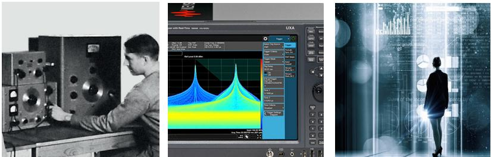

myKeysight

myKeysightwww.keysight.com/find/mykeysight个性化视图为您提供更适合自己的信息！

http://www.keysight.com/find/emt_product_registration注册您的产品，即可获得最新的产品信息并找到保修信息。

KEYSIGHTSERVICES Accelerate Technology Adoption. Lower costs.

# 是德科技服务

www.keysight.com/find/service

是德科技服务提供从仪器采购到更新换代的全套服务，贯穿您的仪器的整个生命周期。我们可以提供全面的一站式校准、维修、资产管理、技术更新、咨询、培训等服务，帮助您提高产品质量并降低成本。

# 是德科技保证方案

www.keysight.com/find/AssurancePlans长达 10 年的周密保护可以避免意外的维修支出，确保您的仪器符合规范要求，精确的测量可使您高枕无忧。

是德科技渠道合作伙伴www.keysight.com/find/channelpartners黄金搭档：是德科技的专业测量技术和丰富产品与渠道合作伙伴的便捷供货渠道强强结合。

如需了解关于是德科技产品、应用和服务的更多信息，请与是德科技联系。如欲获得完整的产品列表，请访问：www.keysight.com/find/contactus

# 美洲

加拿大 (877) 894 4414  
巴西 55 11 3351 7010  
墨西哥 001 800 254 2440  
美国 (800) 829 4444

<table><tr><td colspan="2">亚太地区</td></tr><tr><td>澳大利亚</td><td>1800 629485</td></tr><tr><td>中国大陆</td><td>800 810 0189</td></tr><tr><td>中国香港</td><td>800 938 693</td></tr><tr><td>印度</td><td>1 800 11 2626</td></tr><tr><td>日本</td><td>0120 (421) 345</td></tr><tr><td>韩国</td><td>080 769 0800</td></tr><tr><td>马来西亚</td><td>1 800 888 848</td></tr><tr><td>新加坡</td><td>1 800 375 8100</td></tr><tr><td>中国台湾</td><td>0800 047 866 其他亚太国家和地区 (65) 6375 8100</td></tr></table>

# 欧洲和中东地区

<table><tr><td>奥地利</td><td>0800 001122</td></tr><tr><td>比利时</td><td>0800 58580</td></tr><tr><td>芬兰</td><td>0800 523252</td></tr><tr><td>法国</td><td>0805 980333</td></tr><tr><td>德国</td><td>0800 6270999</td></tr><tr><td>爱尔兰</td><td>1800 832700</td></tr><tr><td>以色列</td><td>1 809 343051</td></tr><tr><td>意大利</td><td>800 599100</td></tr><tr><td>卢森堡</td><td>+32 800 58580</td></tr><tr><td>荷兰</td><td>0800 0233200</td></tr><tr><td>俄罗斯</td><td>8800 5009286</td></tr><tr><td>西班牙</td><td>800 000154</td></tr><tr><td>瑞典</td><td>0200 882255</td></tr><tr><td>瑞士</td><td></td></tr><tr><td rowspan="3"></td><td>0800805353</td></tr><tr><td>可选1 (德国)</td></tr><tr><td>可选2 (法国) 可选3 (意大利语)</td></tr><tr><td>英国</td><td>0800 0260637</td></tr></table>

查看其他未列出的国家或地区的联系方  
式，请访问：  
www.keysight.com/find/contactus  
(BP-9-7-17)www.keysight.com/go/qualityKeysight  
DEKRA 认证，ISO 9001:2015质量管理体系认证  
此信息如有更改，恕不另行通知。$\circledcirc$ 是德科技，2010 年–2017 年2017 年 9 月 6 日，印于北京  
5952-8255CHCN  
www.keysight.com