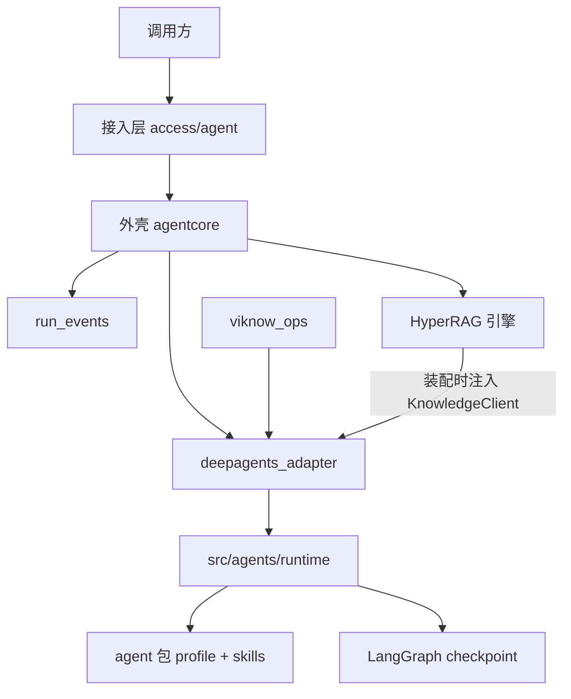
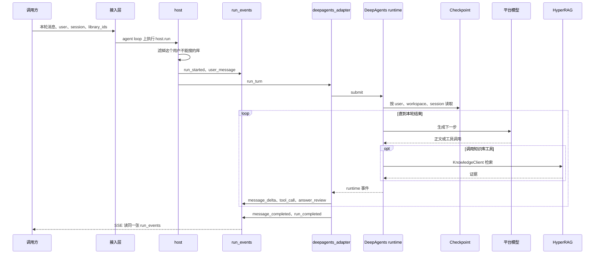
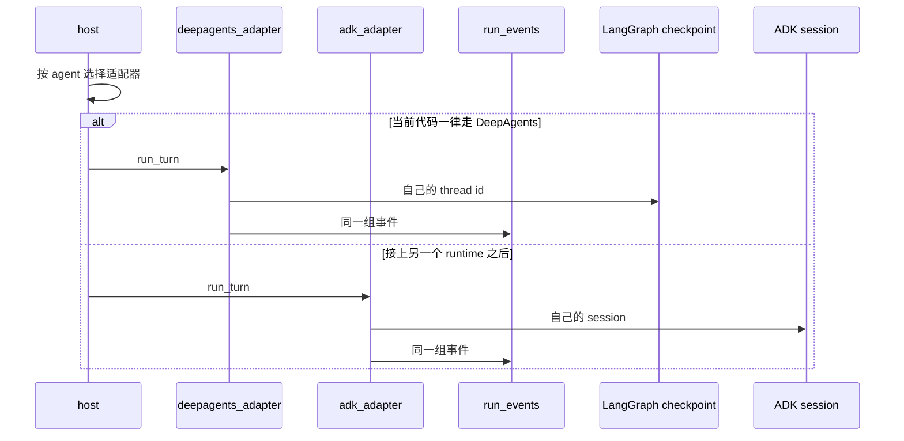

# Agent Runtime

Agent Runtime 是一轮调用的执行面。外壳负责接收请求和写事件。runtime 负责模型、工具、闸门、沙箱，以及它自己的对话上下文。

当前接通的 runtime 是 DeepAgents，代码在 `src/agents/runtime`。外壳通过 `TurnRuntime.run_turn` 调用它。适配器在 `src/viknow3/application/agent/deepagents_adapter/`。

你可以用这层做这些事：

- 在一个已经授权的库范围内跑完一轮工具循环。
- 把 DeepAgents 的输出映射成外壳事件。
- 用 LangGraph checkpoint 记住这个 user、workspace、session 上的 agent 上下文。

## 分层

依赖只有一个方向。`src/agents` 里没有 `import viknow3`。知识库引擎由外壳创建，适配器在 `get_deepagents_runtime` 里调用 `get_engine_adapter()`，把得到的对象当作 `KnowledgeClient` 传给 `build_agent_runtime`。

## 一轮调用

`Orchestrator.start` 生成 `run_id`，把 `host.run` 提交到名为 `viknow-agent-loop` 的常驻 asyncio 循环。这个循环在守护线程上。同步地堵在这条线程里的调用会挡住其他轮次。

`host` 传给适配器的 `AgentTurnInput` 含有 `session_id`、`run_id`、`user_id`、`user_message`、滤过的 `library_ids`、模型名，以及会话行上的 `workspace_id`。没有会话行时 `workspace_id` 为空，checkpoint 键里的 workspace 段用 `default`。

适配器按对外 id 找到 agent 包，每个包装配一次 `DeepAgentsRuntime` 并缓存。`submit` 之后，适配器从 runtime 拉事件，用 `apply_vendor_event` 写成外壳事件。runtime 自己的 `RUN_STARTED` 和 `USER_MESSAGE` 被丢掉，因为外壳已经写过。

## 外壳和 runtime 各持有什么

| 外壳 | runtime |
| --- | --- |
| HTTP、app key、会话和 run | 一轮里的模型、工具、闸门、回答检查、沙箱 |
| `run_events`，以及 run 上的正文、引用、token | LangGraph checkpoint |
| 三个库的连接串 | 用 `VIKNOW_AGENT_DSN` 自己建 checkpointer |
| 平台模型端点 | `runtime.yaml` 里的温度、超时、沙箱、递归上限 |
| HyperRAG 引擎 | `KnowledgeClient` 上的发现、检索、片段和证据 |
| 这一轮允许的库 id | thread id：`{user_id}:{workspace_id 或 default}:{session_id}` |

外壳不创建 `AsyncPostgresSaver`，也不读 checkpoint 的 `channel_values`。只按旧的 `session_id` 存下来的 checkpoint 对不上这个 thread id，下一轮不会续上。

对话模型、监控、Mem0、视频发现的 client 留在 runtime。它们是一轮内部对外部服务的调用。知识库不同：引擎是进程级的，由外壳创建后注入。

`runtime.yaml` 里当前的沙箱是 bubblewrap，虚拟工作区，单文件 25MB，内存 512MB，无网络。模型块只保留温度 0.7、重复惩罚 1.0、最大输入 156000、超时 600 秒。地址和密钥不在这个文件里。

## 再接一个 runtime

HTTP、会话、`run_events` 和库授权不用改。新增两块：

1. 新 runtime 实现自己的循环和自己的 session。session 使用外壳传入的 `user_id`、`workspace_id`、`session_id`。外壳不解析这份 session。
2. 外壳里的适配器实现同一个 `TurnRuntime.run_turn(turn, state, events)`，把输出写成同一组事件。需要检索时使用外壳已经建好的 `KnowledgeClient`。

`host.py` 里现在只有一处写死了 DeepAgents。选择适配器就加在这次调用上。DeepAgents 的 `runtime.yaml`、checkpoint、工具闸门和回答检查留在 `deepagents_adapter` 后面。

代码里还没有 `adk_adapter`。上面的 `else` 是适配点，不是已经接通的路径。

## 下一步

- [会话](sessions.md)
- [事件](events.md)
- [工具和模型](tools.md)
