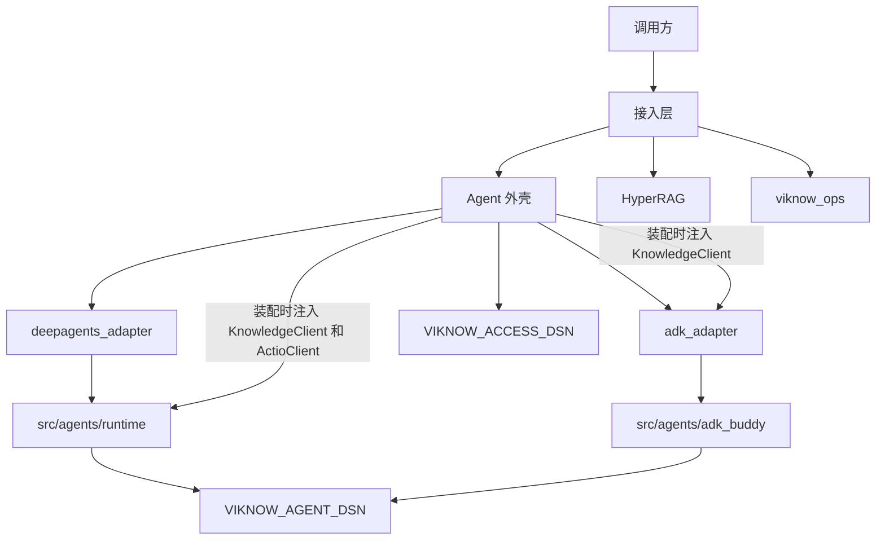

# ViKnow

ViKnow 是一个进程里的接入层加应用层。调用方用 HTTP 建用户、会话和一轮 agent 调用，也可以建知识库并检索。进程启动时拉起 HyperRAG，agent 的每一轮都跑在同一个 agent loop 上。

文档以本仓库代码为准。`src/viknow3` 是外壳，`src/agents` 是 agent 包和共用回合。外壳可以调用 `src/agents`。`src/agents` 不引用 `viknow3`。

你可以用 ViKnow 做这些事：

- 用 app key 调用 `/api/v1/agent`，开始或继续一个会话，并用 SSE 读这一轮的事件。
- 让一个已登记的 agent 在受控的库范围里调用工具，并把用户能看见的问答写入 `run_events`。
- 用 `/api/v1/knowledge` 和 `/api/v1/knowledge/search` 管理库、上传并检索。
- 用管理员凭证读写 `viknow_ops` 里的平台配置。

## 平台由哪几块组成

| 区域 | 代码 | 作用 |
| --- | --- | --- |
| 接入 | `src/viknow3/access/` | HTTP、app key、把请求交给对应 client |
| Agent | `src/viknow3/application/agentcore/` 和 `src/agents/` | 一轮调用、事件、DeepAgents 与 ADK 回合 |
| 知识库 | `src/viknow3/application/hyperrag/` | 索引和检索。引擎由外壳持有，调用方走 HyperRAG client |
| Actio | `src/viknow3/application/actio/` | 视频解析和多模态工具。调用方走 Actio client |
| 运维 | `src/viknow3/ops/` | `viknow_ops` 里的模型、provider 和配置变更 |

三个数据库各管一件事：

| 环境变量 | 库存什么 |
| --- | --- |
| `VIKNOW_ACCESS_DSN` | 用户、会话、workspace、文件、`run_refs`、`run_events` |
| `VIKNOW_AGENT_DSN` | DeepAgents 的 LangGraph checkpoint，以及 ADK 自己的 session |
| `VIKNOW_HYPERRAG_DSN` | 知识库引擎自己的数据 |

进程入口是 `viknow3.server:app`。默认监听 `VIKNOW_HOST` / `VIKNOW_PORT`（缺省 `127.0.0.1:5175`）。Playground 由部署脚本单独拉在 `:5198`。启动时会把上次进程留下的 `running` run 收成失败，并初始化 HyperRAG。

## 鉴权

业务接口要求 `Authorization: Bearer <app_key>`。代码里登记的开发 key 是 `dev-app-key`，它的默认 agent 是 `expertbuddy-deepagents`。无效 key 返回 401，`code` 为 `invalid_app_key`。

`/api/v1/om` 使用另一套管理员凭证，缺省比对 `dev-admin-key`。失败时 `code` 为 `invalid_admin_key`。

## 下一步

- [Agent](agent/overview.md)：一个 agent 是什么，一轮调用怎么走。
- [会话](agent/sessions.md)：用户能看见的历史，和 runtime 自己的上下文。
- [HTTP](agent/http.md)：agent 接口、字段和错误码。
- [知识库](knowledge/overview.md)：引擎、检索，以及 runtime 拿到的 client。
- [接入层数据](data/access.md)：`VIKNOW_ACCESS_DSN` 里的表。
- [配置](ops/configuration.md)：模型端点和 `runtime.yaml`。
